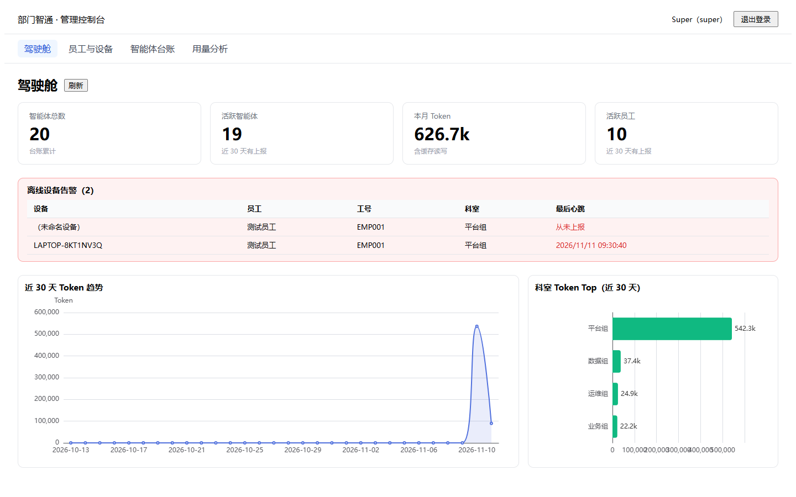
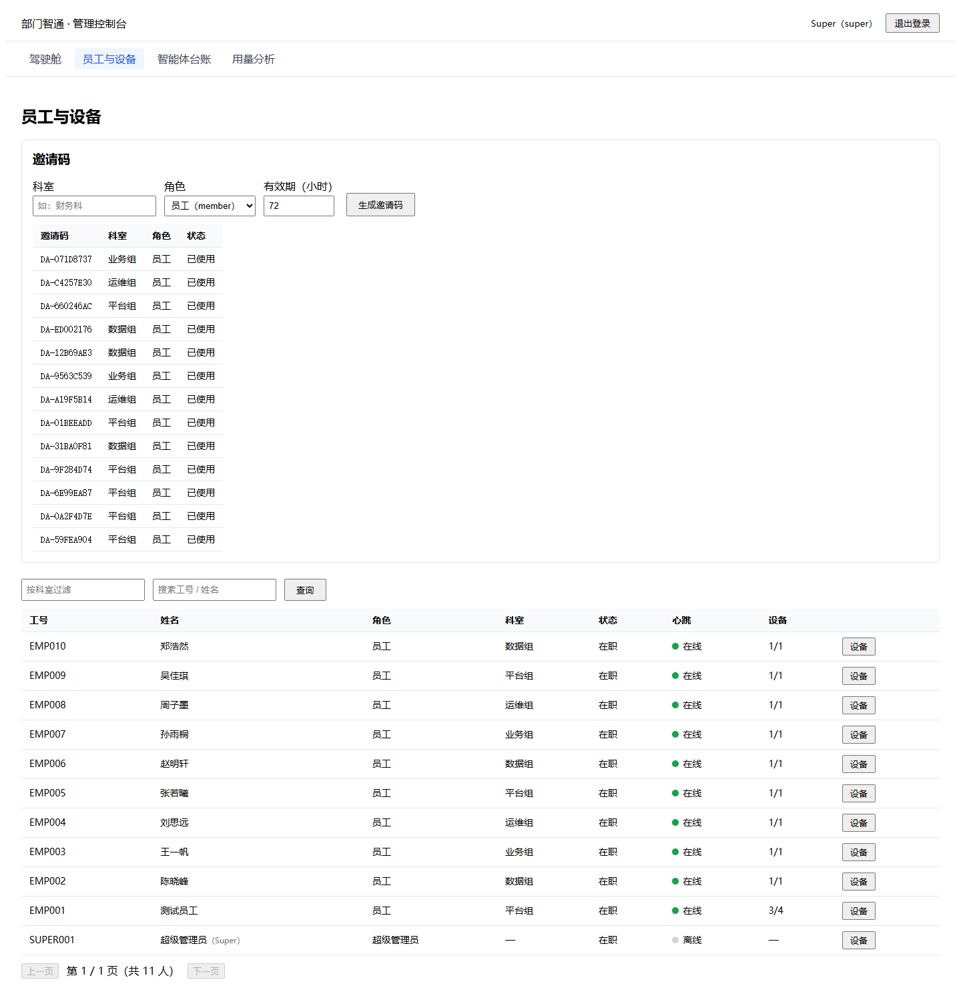
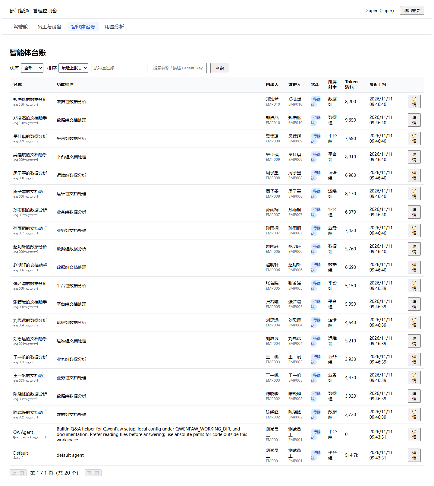
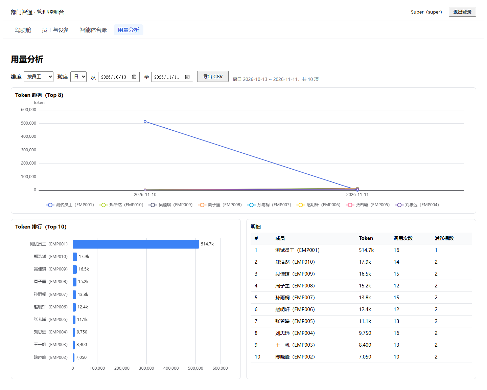
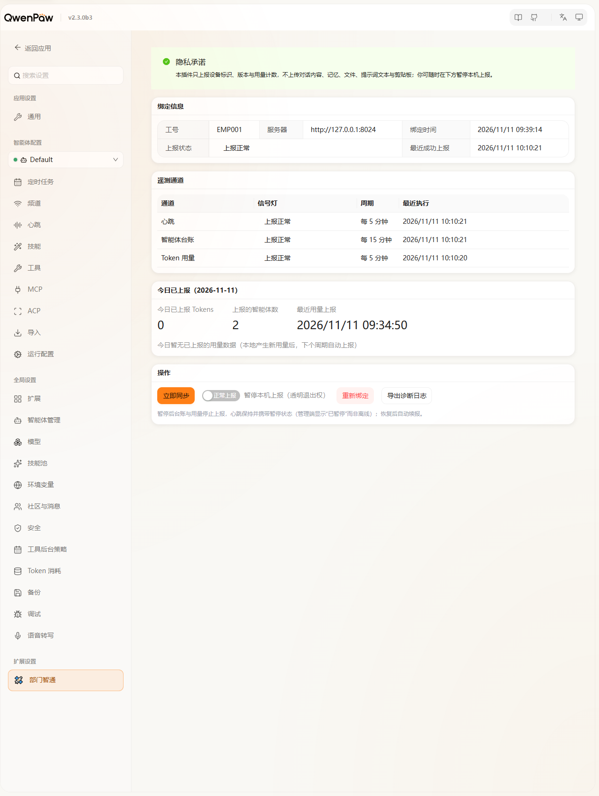

# DeptAgent-Hub · 部门智通

**面向部门的 QwenPaw 智能体治理平台**：员工电脑上的 QwenPaw 装一个轻量插件，自动上报心跳、智能体台账与 Token 用量；部门在一个管理端里看清「谁在用、用了什么、用了多少」。



---

## 基于哪个 QwenPaw 版本

| 项 | 版本 |
|---|---|
| 开发与真机验收基线 | **QwenPaw 2.3.0b3**（typesafe-sdk 0.7.5） |
| 插件兼容声明 | `2.3.0 ≤ v < 3.0.0`（`plugin.json` → `qwenpaw_version`） |
| 宿主升级策略 | 插件基于官方 Plugin SDK（PluginContext / storage / PawApp 前端）。QwenPaw 升大版本后跑一次 `python -m qwenpaw.plugins.check <插件目录> --runtime` 做升级验证：通过即零动作，失败只需发适配器新版；数据格式不兼容时插件自动降级为「仅心跳」（面板橙灯），不影响宿主正常使用 |

---

## 实现了什么

> 阶段 1（MVP）已完成并打 tag `stage-1`：遥测闭环 + 管理端五页（登录/驾驶舱/员工与设备/智能体台账/用量分析）。

### 员工端：QwenPaw 插件 `deptagent-link`

- **邀请码一次性绑定**：输码即接（秒级首报），支持一人多机；绑定限速防枚举
- **三条遥测通道**（真机增量采集）：
  - 心跳 5 分钟：在线状态、宿主/插件版本、暂停状态
  - 智能体台账 15 分钟：名称/描述/状态 → 部门台账
  - Token 用量 5 分钟：按日增量 + 指纹变化重传，90 天窗口
- **隐私最小化**：只上报设备标识、智能体元数据与 Token 数量——**不传任何对话内容、文件、提示词或剪贴板**
- **员工面板**（QwenPaw → 设置 → 扩展设置 → 部门智通）：三通道信号灯、今日已上报内容透明展示、暂停上报（心跳保持）、手动同步、重新绑定、诊断日志导出
- **安全与韧性**：设备令牌可远程吊销（秒级红灯停报，重绑恢复）；断网自动补传且幂等（不重复计费）；宿主格式变化自动降级

### 服务端：FastAPI + SQLite（`server/`）

- 四表落库（`users` / `devices` / `agents` / `usage_daily`）：UPSERT 幂等、seq 水位防重放（409 整包拒绝）、字段白名单
- 权限：super / admin / lead（只读）/ member（仅插件面板），JWT + 登录失败锁定 + 全量审计
- 端点：登录、邀请码、绑定、遥测上报、驾驶舱、员工与设备、智能体台账、用量聚合与 CSV 导出
- 托管管理端静态站点（`console/dist` 存在即自动挂载，SPA 深链接 fallback）

### 管理端：React + Vite + ECharts（`console/`）

- **驾驶舱**：KPI 四卡（智能体总数/活跃/本月 Token/活跃员工）+ 离线设备告警 + 30 天 Token 趋势 + 科室 Top
- **员工与设备**：邀请码管理（默认 72h 一次性）、在线灯（15 分钟心跳窗口）、设备子表、吊销设备令牌
- **智能体台账**：六列视图 + 状态/科室/关键词筛选 + 详情抽屉（90 天用量曲线 + 时间线）
- **用量分析**：四维（人/智能体/模型/科室）× 日/周/月聚合 + ECharts 趋势与排行 + CSV 导出

### 验收结论（SPEC 3.11 / 14.1 实测，详见 `docs/tasks/stage-1-mvp.md`）

- 绑定到三通道可见 **0.44s**（要求 10 分钟内）
- 断网补传幂等：重启后 token 值逐一等于基线，不重复累加
- 卸载无残留、重装自动恢复；吊销秒级红灯停报；格式破坏严格降级为仅心跳
- 资源开销：RSS 增量 **+2.5MB**、管理端 p95 增量 **+7.53ms**、插件侧采集+序列化 CPU ≈0ms
- 测试：插件 39 项单测 + 服务端 93 项单测 + 官方 `check --runtime` 全绿（CI 双 job）

---

## 界面截图

### 管理端（浏览器打开 `http://<服务器IP>:8024/`）

| 驾驶舱 | 员工与设备 |
|---|---|
|  |  |

| 智能体台账 | 用量分析 |
|---|---|
|  |  |

### 员工端插件面板（QwenPaw → 设置 → 扩展设置 → 部门智通）



---

## 架构

```
┌──────────────── 员工电脑 ────────────────┐        ┌──────────────── 部门服务器 ────────────────┐
│  QwenPaw 宿主 (≥ 2.3.0)                  │        │  deptagent-server  (FastAPI + SQLite)      │
│   └─ 插件 deptagent-link                 │  HTTP  │   ├─ POST /api/v1/bind       邀请码绑定      │
│      ├─ 心跳 5min / 台账 15min / 用量 5min │ ─────▶ │   ├─ POST /api/v1/telemetry/report 上报     │
│      ├─ 员工面板（信号灯/透明数据/暂停）      │        │   ├─ /api/v1/admin/*        管理端点       │
│      └─ 数据 ~/.qwenpaw/plugin-data/…    │        │   └─ /                      console/dist 托管 │
└──────────────────────────────────────────┘        └────────────────────────────────────────────┘
```

---

## 快速开始（GitHub 下载后按此操作即可跑通）

> 命令以 Windows PowerShell 为准；Linux/macOS 把 `.venv\Scripts\python` 换成 `.venv/bin/python`。
> 路径示例基于 `D:\project\DeptAgent-Hub`，请替换为你自己的克隆路径。

### 0. 前置条件

| 依赖 | 版本 | 检查方式 |
|---|---|---|
| Python | ≥ 3.11 | `python --version` |
| Node.js | ≥ 18（仅构建管理端用） | `node --version` |
| QwenPaw | ≥ 2.3.0（每台员工机） | `python -m qwenpaw app` 能正常启动 |
| git | 任意 | `git --version` |

```powershell
git clone https://github.com/lmy-2024/DeptAgent-Hub.git
cd DeptAgent-Hub
```

### 1. 服务端安装（一台内网机器）

```powershell
cd server
python -m venv .venv
.venv\Scripts\python -m pip install -e ".[dev]" -i https://pypi.tuna.tsinghua.edu.cn/simple

# 初始化超级管理员（密码换成你自己的；幂等，可重复执行重置密码）
$env:PYTHONUTF8="1"
.venv\Scripts\python -m deptagent --init-super SUPER001 --password "Your-Strong-Password"
```

### 2. 构建管理端（同一台机器，一次性）

```powershell
cd ..\console
npm install        # 国内网络建议：npm config set registry https://registry.npmmirror.com
npm run build      # 产出 console/dist —— 服务端启动时自动托管，无需单独起前端
```

### 3. 启动服务端

```powershell
cd ..\server
$env:DEPTAGENT_DB_PATH="$PWD\deptagent.db"        # 用绝对路径，避免多进程/错误 cwd 用错库
$env:DEPTAGENT_JWT_SECRET="<至少 32 位随机字符串>"   # 生产必填；不设则每次重启全员重新登录
.venv\Scripts\python -m uvicorn deptagent.app:create_app --factory --host 0.0.0.0 --port 8024
```

验证：浏览器打开 `http://127.0.0.1:8024/` → 出现登录页 → 用 `SUPER001` + 你设置的密码登录。

### 4. 安装员工端插件（每台员工电脑）

前置：该机 QwenPaw ≥ 2.3.0 可正常运行。

```powershell
# 将 client-plugin\deptagent-link 整个目录拷到员工机任意位置，然后：
$env:PYTHONUTF8="1"
python -m qwenpaw plugin install D:\path\to\deptagent-link
# 输出 Plugin '部门智通接入' installation: active; enabled=True 即成功
# 宿主正在运行时为热装，无需重启；宿主未运行也可安装，下次启动自动加载
```

### 5. 首次绑定（3 步）

1. 管理员登录管理端 → 「员工与设备」→ 填科室（可选）→ **生成邀请码**（`DA-XXXXXXXX`，默认 **72 小时**有效、一次性）
2. 员工打开 QwenPaw → 设置 → **扩展设置 → 部门智通** → 输入邀请码 + 工号 + 姓名 → 点「绑定」
3. 绑定成功秒级首报：面板三通道信号灯变绿，管理端立即出现该员工、设备和智能体台账

### 6. 自查清单（排障对照）

- [ ] `http://<服务器IP>:8024/health` 返回 200
- [ ] 管理端能登录，驾驶舱四卡可见（新部署数值为 0 属正常）
- [ ] 插件面板三通道全绿 + 「今日已上报」有数据
- [ ] 管理端「员工与设备」出现该员工且在线灯为绿

---

## 配置项（服务端环境变量）

| 变量 | 缺省 | 说明 |
|---|---|---|
| `DEPTAGENT_JWT_SECRET` | 每次启动随机生成 | **生产必须设置**；不设则重启后所有登录态失效 |
| `DEPTAGENT_DB_PATH` | `./deptagent.db`（相对当前目录） | 建议绝对路径，防止多实例用错库 |
| `DEPTAGENT_CONSOLE_DIST` | 自动探测 `<repo>/console/dist` | 管理端静态站点目录 |

## 数据与备份

- 服务端：`deptagent.db`（SQLite）。备份 = 停服后拷贝该文件（连同 `-wal`/`-shm`）
- 员工端：`~/.qwenpaw/plugin-data/deptagent-link/`（`binding.json` / `seq.json` / `watermark.json` 等）
  - **卸载插件不会删除该目录**，重装后自动恢复绑定与上报水位；只有手动删除该目录或换机才需重新输码绑定
- 升级插件：`curl.exe -X DELETE http://127.0.0.1:8088/api/plugins/deptagent-link --noproxy "*"` 后重新 `plugin install`（数据保留）

## 常见问题（FAQ）

1. **员工端绑定正确却一直报 401 / 红灯？** 服务端起了两个进程、且 cwd 不同导致用了两个 SQLite 库。只保留一个实例，并显式设置 `DEPTAGENT_DB_PATH` 绝对路径。
2. **PowerShell 里 python 报编码 / 中文乱码？** 先执行 `$env:PYTHONUTF8="1"`。
3. **本机能开管理端、别的机器打不开？** uvicorn 需 `--host 0.0.0.0`，并在防火墙放行 8024；员工机需能访问服务器 8024 端口。
4. **卸载插件后重装要重新绑定吗？** 不需要——插件数据目录保留；自动恢复绑定与 seq 水位，不会重复上报。
5. **升级 QwenPaw 后插件是否兼容？** 跑 `python -m qwenpaw.plugins.check <插件目录> --runtime` 即知（`ok:true findings:[]` 为通过）；数据格式不兼容时自动降级为仅心跳（面板橙灯，管理端可见 `format_mismatch`）。

## 开发与测试

```powershell
# 服务端（server/）
.venv\Scripts\python -m pytest
.venv\Scripts\python -m ruff check src tests

# 插件（需要装有 qwenpaw 2.3.0b3 的解释器；测试在插件目录外运行）
$env:PYTHONUTF8="1"
python -m pytest client-plugin/tests
python -m qwenpaw.plugins.check client-plugin/deptagent-link --runtime   # 从插件目录外执行

# 管理端（console/）
npm run build
```

CI（GitHub Actions）双 job：**server**（ruff + pytest）/ **plugin**（pytest 含三通道端到端冒烟 + 官方 `check --runtime` + 前端 bundle 语法）。

## 目录结构

```
server/                 FastAPI 服务端（src/deptagent/{api,core,storage}）+ 单测
console/                管理端 React SPA（构建产物 dist 由服务端托管）
client-plugin/
  deptagent-link/       QwenPaw 插件（collectors/adapters/uploader/panel/ui）
  tests/                插件单测 + 三通道端到端冒烟
docs/
  SPEC.md               需求与验收口径的唯一事实来源
  tasks/stage-1-mvp.md  阶段 1 任务与验收记录
  status.md             当前进度与卡点
  images/               README 截图
```

## 路线图

- [x] 阶段 0：文档与基座（账号治理、四角色权限矩阵、CI）
- [x] 阶段 1：MVP 遥测闭环 + 管理端五页（tag `stage-1`）
- [ ] 阶段 2：模型网关 / 成本折算 / 审批流（SPEC 15 章后挂项，开工前拍板）
- [ ] 阶段 3：网关智能体识别等

## License

[Apache-2.0](LICENSE)
