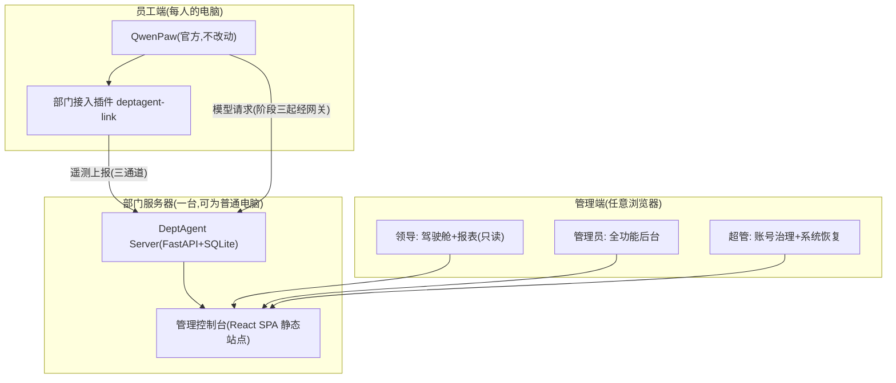
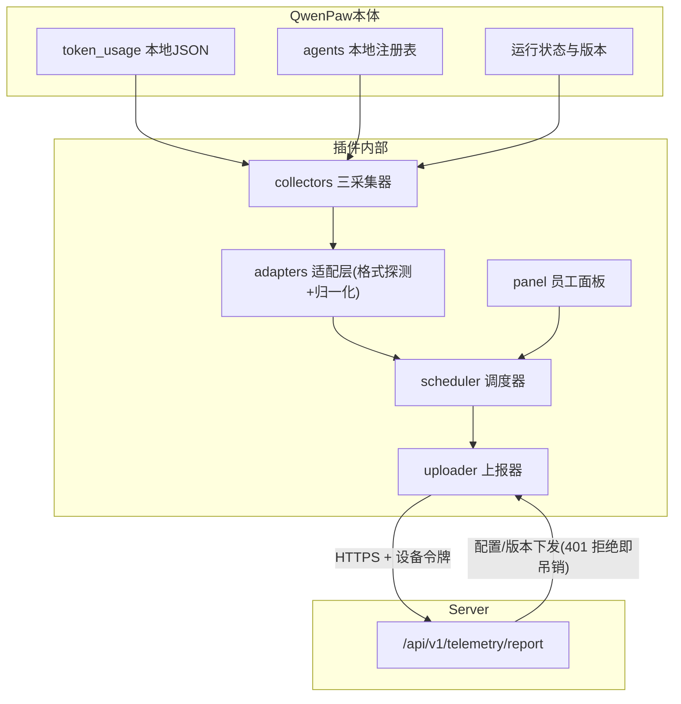
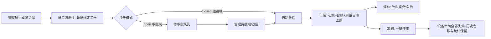
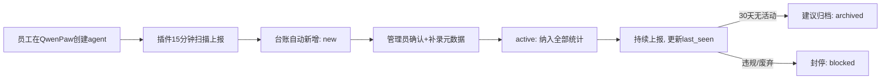
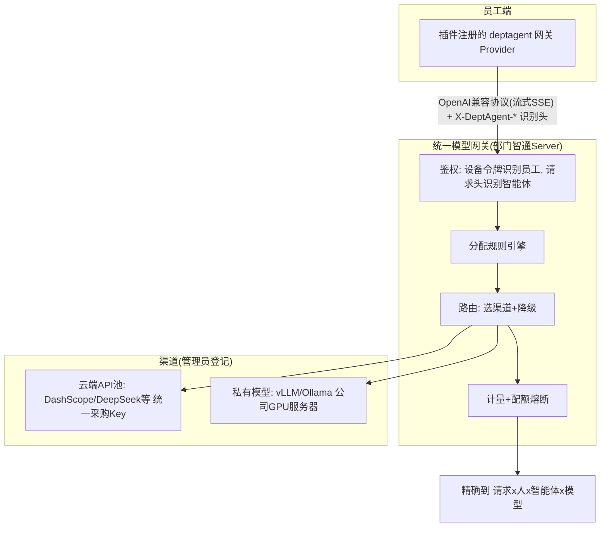

# 部门智通（DeptAgent-Hub）产品与技术规格书

| 项目 | 内容 |
| --- | --- |
| 版本 | v0.6（草案 · 版本口径修订） |
| 状态 | 待审查 |
| 修订记录 | v0.2：插件约定源码级校准；v0.3：吸收评审——修复 agent_key 唯一性、价格生效时间、归属语义、面板前后端分层，补充上游吸收/单人维护风险与可测验收指标；v0.4：权限模型拍板——四角色（super/admin/lead/member）层级化：super 为账号治理与系统恢复入口、admin 仅由 super 创建、改角色即改权限（不做逐权限位编辑）；v0.5：源码校验复审——修正 WAL 备份/register_provider 语义/429 断言/吊销交互语义，补 devices 表与 UPSERT 字段白名单、双 source 合并 VIEW、API 通用约定与安全算法基线，新增决策点 D9–D11；v0.6：版本口径修正——插件体系断言/依据/复用地图 v2.2.2→v2.3.0b3（源码校准实际版本 + 真机全链路验证），manifest `min` 2.2.2→2.3.0（2.2.x 宿主缺新 SDK 实测不兼容；宿主将 pre-release 归一化为基版本比较，2.3.0b3 真机可装载），数据格式适配器与格式族标签 2_2→2_3 |
| 目标读者 | 项目发起人（审查决策）、后续实现者 |
| 依据 | 与发起人的多轮架构讨论沉淀；QwenPaw v2.3.0b3 插件机制经源码级校验（`plugins/architecture.py`、`sdk.py`、`sdk_version.py`、`validation.py`、`_version_compat.py`）+ 真机验证（hello 模板热装/禁用/启用闭环、`check --runtime` 全绿） |
| 审查方式 | 重点审查第 15 章"开放决策点"，其余章节为已讨论共识的书面固化 |

---

## 目录

1. [产品概述](#1-产品概述)
2. [总体架构](#2-总体架构)
3. [员工端：QwenPaw + 部门接入插件](#3-员工端qwenpaw--部门接入插件)
4. [管理端：Web 管理控制台](#4-管理端web-管理控制台)
5. [员工与智能体管理机制](#5-员工与智能体管理机制)
6. [模型接入与分配管理（阶段三）](#6-模型接入与分配管理阶段三)
7. [数据模型](#7-数据模型)
8. [API 协议](#8-api-协议)
9. [部署要求与形态](#9-部署要求与形态)
10. [非功能需求](#10-非功能需求)
11. [实施路线图](#11-实施路线图)
12. [风险与对策](#12-风险与对策)
13. [仓库结构与 GitHub 发布计划](#13-仓库结构与-github-发布计划)
14. [验收标准](#14-验收标准)
15. [开放决策点（待拍板）](#15-开放决策点待拍板)
16. [附录：参考项目复用地图](#16-附录参考项目复用地图)

---

## 1. 产品概述

### 1.1 背景

部门内员工需要个人 AI 智能体完成日常工作（文档、报表、信息收集、办公自动化）。现状问题：智能体各自为政、无台账；模型 API Key 分散在个人手中，用量与成本不可见；无统一管理视角。

### 1.2 定位

部门级别的智能体**使用、开发和管理平台**。一句话：**员工每人一个 QwenPaw（客户端），领导和管理员共用一个浏览器里的管理站点，部门统一掌握模型接入与成本。**

### 1.3 用户角色

| 角色 | 使用界面 | 核心诉求 |
| --- | --- | --- |
| 普通员工（member） | QwenPaw + 插件小面板 | 顺畅使用智能体，知道自己的用量 |
| 部门领导（lead） | 管理控制台（只读视角） | 一屏看全部门：智能体数量/功能/创建人维护人/Token 消耗/成本 |
| 管理员（admin） | 管理控制台（全功能） | 员工准入、台账治理、模型分配、配额与告警 |
| 超级管理员（super） | 管理控制台（全页可见，专属账号管理页） | 账号治理与系统恢复：创建/停用管理员、调整任何账号角色、重置密码；不参与日常治理 |

**四角色权限模型（已拍板）**：权限按角色包含向下兼容（super ≥ admin ≥ lead ≥ member）。super 部署时经 `--init-super` 命令行初始化，建议 1–2 个、独立持有、**绝不共享**（一人一号是审计可追责的前提）；admin 仅由 super 创建（邀请码不得签发 admin 及以上角色）；权限调整 = super 修改账号 `role` 字段——**改角色即改权限**，不做逐权限位编辑（部门规模下预设角色足够，自定义权限编辑器成本收益不成比例）。全部角色变更写入审计日志。

### 1.4 产品形态总览



### 1.5 术语表（全文统一口径）

| 术语 | 定义 |
| --- | --- |
| agent_key | 员工本地 QwenPaw 中智能体的 workspace 标识（源码即 `workspace_id`）；仅在同一员工内唯一，服务端以 `(owner_user_id, agent_key)` 联合唯一定位 |
| definition_key | 同模板/同源智能体的全部门聚合键（管理员归并补录，可空） |
| 设备令牌 | 绑定时签发的长期凭据：`secrets.token_urlsafe(32)` 生成，库内只存 SHA-256 哈希，明文仅绑定响应返回一次，可吊销 |
| provider_id / channel | 同一概念两种口径：遥测报文字段名 `provider_id`（如 dashscope），网关与 `model_catalog` 表用 `channel`——二者按字符串值直接对应，报表统一按 provider 维度聚合 |
| source（client/gateway） | 用量数据双来源：客户端自报 `client` / 网关精确计量 `gateway`，报表合并口径见 7.2 |
| stat_date | 员工本地日期（`YYYY-MM-DD`，客户端生成、服务器不做时区换算）；库内其余时间戳一律 UTC ISO 8601 |
| 台账六列 | 数量 / 功能 / 创建人 / 维护人 / 状态 / Token（领导视角报表固定口径） |

---

## 2. 总体架构

### 2.1 三大架构决策

| # | 决策 | 内容 | 理由 |
| --- | --- | --- | --- |
| A1 | **零 fork** | QwenPaw 官方包原样使用，不 fork、不打补丁，部门能力全部通过插件外挂 | QwenPaw 迭代快（近乎月更），fork 会造成持续合并负担，阻断部门管理平面的稳定运行 |
| A2 | **B 起步 → C 演进** | MVP 用"客户端上报"（模式 B）快速出统计；阶段三引入"统一模型网关"（模式 C）实现精确计量与硬管控 | B 便宜快速但数据可自报不可信；C 是精确计量与硬配额的前提；演进不返工 |
| A3 | **协议独立** | 员工端与服务器之间的上报协议（`/api/v1/`）独立演进、宽松校验，与 QwenPaw 版本解耦 | 上游格式变化只影响插件内一个适配器文件，服务器与管理端零改动 |

### 2.2 演进模式对比（决策依据存档）

| | 模式 A：Hub 托管 | 模式 B：客户端上报（MVP） | 模式 C：统一网关（终态） |
| --- | --- | --- | --- |
| 形态 | 服务器为每员工起隔离 QwenPaw 容器 | 员工本地装 QwenPaw，插件上报统计 | 模型请求统一走部门代理 |
| 员工本地安装诉求 | 不匹配 | **匹配** | **匹配** |
| Token 计量 | 需二次聚合 | 自报（不准） | **网关精确** |
| 硬配额 | 难 | 仅软限 | **可硬限** |
| 服务器成本 | 高 | 极低 | 低 |
| 定位 | 阶段四兜底（无本地条件员工） | 阶段一至二 | 阶段三起 |

### 2.3 管理能力分级（对上级汇报口径，须明示）

| 管理动作 | 模式 B（MVP） | 模式 C（网关后） |
| --- | --- | --- |
| 停用员工 | 吊销令牌、阻断上报、移出统计 | 同时阻断其一切模型调用 |
| 封停智能体 | 台账标记 + 统计剔除（本地仍可跑） | 网关拒绝该智能体请求（真停） |
| Token 配额 | 软限（80% 告警、超限通报） | 硬限（超额熔断，返回 429） |
| 统计/台账 | 完整 | 完整且精确 |

> MVP 管理边界 = "看得见全貌、管得住入口（上报权）"；"管得住运行"由阶段三网关补齐。

---

## 3. 员工端：QwenPaw + 部门接入插件

### 3.1 定位与三条铁律

一句话：员工 QwenPaw 里的"归队模块"——**只读采集、协议上报、零侵入**。

1. **只读**：对 QwenPaw 一切数据只读取，绝不写业务数据；
2. **旁路**：采集/上报为独立 asyncio 任务，聊天请求路径零延迟增加；
3. **幂等**：所有上报可安全重传，服务器 UPSERT，断网补传不重复计数。

### 3.2 插件包结构（对齐 QwenPaw 官方插件 SDK 约定，已源码校准）

QwenPaw v2.3.0b3 插件体系核心事实（源码验证 + 真机验证）：

- 安装位置：`~/.qwenpaw/plugins/<plugin_id>/`（`PLUGINS_DIR`），每插件一目录；支持 zip 导入安装（Console 插件页 / REST `/plugins` / CLI）；
- manifest `plugin.json` 由 Pydantic `PluginManifest` 校验，未知顶层字段忽略；
- 后端入口由 `entry.backend` 指定（官方模板用 `main.py`）；入口模块**必须导出模块级 `plugin` 实例**，宿主调用 `plugin.register(context)`，context 为公共 SDK 的 `PluginContext`（`from qwenpaw.plugins import PluginContext`）；
- 插件 ID 规则：`[A-Za-z0-9][A-Za-z0-9_-]*`（`deptagent-link` 合法）；
- 多文件与相对导入受官方支持（validation 语义与加载器一致）；插件代码运行于**模块隔离环境**（受限 builtins、独立 sys.path、generation 生命周期管理）。

包结构：

```
deptagent-link/
├── plugin.json                  # manifest（见下）
├── main.py                      # entry.backend 入口：导出 plugin 实例
├── binding.py                   # 邀请码 → 设备令牌 绑定流程
├── config.py                    # 服务器地址 / 员工偏好
├── collectors/
│   ├── heartbeat.py             # ① 心跳
│   ├── agents.py                # ② 智能体台账
│   └── usage.py                 # ③ Token 用量(含增量 diff)
├── adapters/
│   ├── base.py                  # Reader 接口 + 格式探测/降级判定
│   └── qwenpaw_2_3.py           # QwenPaw 2.3.x 数据格式适配器
├── uploader.py                  # 批量上报 + 指数退避 + 幂等
├── scheduler.py                 # 常驻调度(仅可在 on_activate 内启动)
├── panel/                       # 员工侧面板前端(entry.frontend bundle)
└── diagnostics.py               # 自检 / 手动同步 / 诊断导出
```

`plugin.json` 示例（字段均为源码确认的真实语义）：

```json
{
  "id": "deptagent-link",
  "name": "部门智通接入",
  "version": "1.0.0",
  "description": "将本机 QwenPaw 接入部门智通：上报心跳、智能体台账与 Token 用量",
  "type": "general",
  "entry": { "backend": "main.py", "frontend": "panel/index.js" },
  "qwenpaw_version": { "min": "2.3.0", "max": "3.0.0" },
  "sdk": {
    "version": "1.0.0",
    "capabilities": ["storage", "logging", "config", "events", "commands", "providers"],
    "secrets": ["device_token"]
  }
}
```

字段说明（均为源码验证）：

| 字段 | 约束 |
| --- | --- |
| `id` / `version` | 必填；id 匹配 `[A-Za-z0-9][A-Za-z0-9_-]*` |
| `type` | 枚举值：`tool/provider/hook/command/channel/hub/memory/frontend/app/general`；缺省按 `meta` 推断。本插件为多能力插件，取 `general` |
| `entry.backend` | Python 入口；`entry.frontend` 为前端 JS bundle 入口（见 3.8）；`entry.descriptor` 与 backend 互斥 |
| `qwenpaw_version` | `{min, max}`，语义 `>=min, <max`（左闭右开）；**max 缺省 = min 同 minor 的全部 patch 版本**。本插件 `min: "2.3.0"`（新插件 SDK 自 2.3 起；宿主将 pre-release 版本归一化为基版本比较，2.3.0b3 真机可装载）+ 显式 `max: "3.0.0"` 覆盖 2.3.x 至 3.0.0 前全部版本 |
| `sdk.version` | 当前宿主 SDK 版本为 `1.0.0`；请求版本须同 major 且 ≤ 宿主支持版本 |
| `sdk.capabilities` | 合法值共 18 个：`tools/logging/models/resources/storage/messages/config/commands/hooks/prompts/modes/skills/markets/providers/memory/events/apps/channels` |
| `sdk.secrets` | 声明插件需要的加密设置名（设备令牌走此机制，不落明文） |

**运行时纪律（源码强约束，实现必须遵守）**：

1. **后台任务必须在 `context.on_activate(callback)` 内创建**——在 `register()` 中创建资源会被宿主以 `ResourceError`（"Create resources in on_activate(), not register()"）直接拒绝。本插件的调度器、上报循环全部在 activate 回调内启动；
2. `register(context)` 内只做声明式注册（命令 / 事件订阅 / Provider），不执行 IO；
3. 插件持久化数据只能写入 `~/.qwenpaw/plugin-data/deptagent-link/`（`context.storage`，提供 `aread_json/awrite_json`）——离线上报队列、增量水位、绑定状态存于此；媒体文件走 `context.media`；
4. 插件有 generation 生命周期与 stale 检测：被禁用/升级/替换后，旧 context 的一切调用抛 `StaleContextError`——调度器须将此异常视为正常停机信号并安静退出；
5. 公共 SDK 类型只从 `qwenpaw.plugins.*` 导入，不触碰宿主内部对象。

### 3.3 数据流



采集触发为**双通道**：定时轮询（scheduler 周期读取本地数据）为主；事件订阅（`context.subscribe_events`，观察 `RunEvent`：含 user/agent(workspace)/session/channel/kind/timestamp）为辅，仅用于即时刷新智能体 `last_seen` 与活跃信号。事件为只读观察且不含 token 计数，用量数字仍以定时读取 `TOKEN_USAGE_FILE`（支持 `QWENPAW_TOKEN_USAGE_FILE` 环境变量覆盖）为准。

PluginContext 完整能力（13 个公开方法，源码确认）：`on_activate`、`register_tool`、`register_command`（聊天 /斜杠命令）、`register_hook`、`register_channel`、`register_prompt`、`register_mode`、`register_skills`、`register_market`、`register_provider`（注册模型 Provider，阶段三使用，见 6.2）、`register_memory`、`subscribe_events`、`register_app`；属性：`plugin_id / config / storage / media / resources / logger`。

### 3.4 采集清单与隐私红线

| 通道 | 频率（默认，见决策点 D2） | 字段 |
| --- | --- | --- |
| ① 心跳 | 5 min | 设备名、OS、QwenPaw 版本、插件版本、运行时长、绑定状态、格式探测结果、**暂停上报开关状态**（`reporting_paused`，见下） |
| ② 智能体台账 | 15 min + 变更时 | agent_key、名称、描述（员工自填功能说明）、状态；**归属（创建人/科室）由服务端按上报设备令牌登记，客户端不自报**（见 8.1） |
| ③ Token 用量 | 5 min | 日期、agent_key（**可空**：本地记录无智能体归属时为 null，服务端归入"未归属"，见 8.1）、provider、model、prompt/completion/cache_read/cache_write tokens、call_count |

> 用量口径声明：QwenPaw 本地 token 记录另含 `cache_eligible_input_tokens`、`cache_observed_calls` 字段（源码 `token_usage/manager.py`），本插件不上报，仅取上表六项计数。

**隐私红线（分域声明，写入面板常驻展示）**：

- **遥测三通道（本节红线）**：不上传对话内容、记忆、文件、提示词文本、剪贴板——只传计数与元数据。员工面板实时展示"本机今日已上报内容"，并提供"暂停本机上报"开关（透明退出权）；
- **网关模式（阶段三起，另域声明）**：对话内容以 OpenAI 兼容转发形式流经网关，默认**不落盘、仅计量**（计费 token 数）；涉密关键词检测的扫描规则与命中范围由管理员配置，并明示于员工面板与全员告知；检测命中仅记录规则标识，不存原文。

**暂停上报与离线告警的关系**：员工主动暂停时，开关状态随下一次心跳上报（`reporting_paused: true`，见 8.1），服务端在 `devices.reporting_paused` 置位；驾驶舱"离线设备告警"排除已暂停设备，员工面板与管理端显示"已暂停"状态而非离线误报。

### 3.5 首次绑定流程

邀请码 → 服务器校验并签发长期**设备令牌**（可吊销）→ 令牌经 manifest `sdk.secrets` 声明的加密设置机制存储（不落明文，受 QwenPaw 密钥保护体系约束）→ 立即触发首次全量上报（台账 + 历史用量回灌，深度见决策点 D3）。

### 3.6 增量同步算法（usage 通道）

本地 token 文件按日聚合、当日持续累加。策略：**当日数据每次全量重传（UPSERT 覆盖）、历史日仅在变化时重传**。简单、幂等、无指针漂移。

### 3.7 容错与降级链

| 异常 | 行为 |
| --- | --- |
| 网络失败 | 指数退避 30s→1m→5m→15m 封顶；离线数据本地排队（上限 5MB，超限丢最老心跳、保用量） |
| 数据格式不兼容（上游升级改格式） | 自动降级"仅心跳"，上报 `format_mismatch` 事件 → 管理端黄灯 → 插件发适配器更新 |
| 令牌被吊销 | 上报请求收到 401 + 错误码 `token_revoked`（见 8.5 错误语义）即停止上报，面板红灯提示重新找管理员；"即将吊销"预通知经心跳响应 `revoked` 字段下发（可选，阶段二起） |
| 服务器 5xx | 退避重试，面板黄灯 |

### 3.8 员工面板（QwenPaw 设置内一页）

- 状态卡：绑定信息（工号/姓名/服务器）、三通道信号灯 + 最近成功时间、今日已上报 token 数；
- 操作：立即同步 / 暂停本机上报 / 重新绑定 / 导出诊断日志；
- 顶部常驻一句话隐私承诺。

面板实现为**前后端两件独立的事**（不 fork、不改动 console 源码）：

- **展示层**：manifest `entry.frontend` 指向 JS bundle，由 console 动态加载并注册到插件 UI 体系（插槽 Slot / 路由 / 菜单，源码 `console/src/plugins/registry`）——Python 端不画 UI；
- **数据层**：面板状态、手动同步、诊断数据由插件后端提供接口供前端调用（官方载体为 PawApp：`register_app` 即"backend router + UI page"一体，或工具/命令 + `context.storage`）。实现时以公共 SDK 实际提供的路由能力为准，不虚构宿主 API。

### 3.9 版本兼容与自更新

- manifest 声明 `qwenpaw_version`：语义 `>=min, <max`（左闭右开）；**max 缺省时仅覆盖 min 同 minor 的 patch 版本**（如 min=2.2.2 无 max → 仅允许 2.2.x）——本插件声明 `min: "2.3.0", max: "3.0.0"`（覆盖 2.3.x 及后续 2.x minor，3.0 发布时再评估抬升；宿主对 pre-release 按基版本归一化比较，2.3.0b3 真机满足 min）；
- `sdk.version` 声明 `1.0.0`（宿主 SDK 主版本内兼容）；适配层运行时结构嗅探探测本地数据格式；
- 心跳响应携带 `plugin_latest`，面板提示一键更新；
- **官方验证工具链**（纳入本插件 CI）：`python -m qwenpaw.plugins.check <插件目录>`（静态校验 manifest/入口/导入）、`--runtime`（在隔离测试宿主 PluginTestHost 中真实执行加载/激活/清理，可用 `PluginTestHost.call_tool` 驱动工具）；
- **升级验证流水线**：QwenPaw 官方发版 → CI 用新版起容器装插件跑 `check --runtime` + 三通道冒烟 → 通过零动作；失败只发适配器新版。服务器与管理端零改动。

### 3.10 员工端安装与分发

| 方式 | 操作 | 适用 |
| --- | --- | --- |
| Tauri 桌面安装包（推荐） | 双击 setup.exe，零依赖 | 普通员工 |
| pip | `pip install qwenpaw` | 技术型员工 |
| IT 集中分发（可选） | 域环境 GPO/SCCM/MSI 推送 | 有 IT 资源的部门 |

安装后"归队三步"：装 QwenPaw → 装插件（部门内网 zip 导入或内部 pip 源）→ 输邀请码绑定。全程约 5 分钟。
Windows LTSC/受限 PowerShell 场景沿用 QwenPaw 官方兜底方案（手动 PATH 配置），不额外处理。

### 3.11 插件验收标准

1. 全新 QwenPaw 2.3.x + 插件安装绑定，10 分钟内管理端可见三通道数据；
2. 断网 24h 恢复：数据补传、计数无重复（幂等验证）；
3. 卸载插件后 QwenPaw 功能无损、无残留后台任务；
4. 篡改本地 token 文件模拟格式破坏：降级仅心跳、面板黄灯、管理端收到事件；
5. 管理端吊销令牌：5 分钟内客户端红灯停报；
6. 资源开销（同进程可测口径）：插件启用前后宿主**增量 RSS < 20MB**；上报期间宿主**事件循环 p95 延迟增量 < 10ms**；**单次上报 CPU 时间 < 200ms**；
7. 通过官方验证工具链：`python -m qwenpaw.plugins.check ./deptagent-link --runtime` 全绿（隔离宿主内加载/激活/清理无泄漏）。

### 3.12 插件开发约束清单（实现者必读，源码级硬约束汇总）

违反任何一条都会在加载或运行期被宿主拒绝/破坏生命周期：

1. manifest `type` 必须取枚举值（本插件 `general`），不存在 middleware 类型；
2. 入口文件（`entry.backend`）必须导出模块级 `plugin` 实例，宿主调用 `plugin.register(self, context: PluginContext)`；
3. **后台任务/资源只能在 `context.on_activate()` 内创建**，`register()` 内创建抛 `ResourceError`；
4. `qwenpaw_version` 语义 `>=min, <max`，**max 缺省仅覆盖同 minor patch**——必须显式声明 `max`；
5. 持久化只写 `~/.qwenpaw/plugin-data/<id>/`（`context.storage`）；令牌等机密走 manifest `sdk.secrets` 声明的加密设置，不落明文；
6. 面板 UI 与数据接口分层：`entry.frontend` JS bundle 仅负责展示，数据由后端接口提供（见 3.8）；
7. 所有 SDK 类型仅从 `qwenpaw.plugins.*` 公共命名空间导入；旧内部接口（如 `api.register_market_provider`）不得使用；
8. 升级/禁用/替换后旧 context 一切调用抛 `StaleContextError`——视为正常停机信号，安静退出；
9. 发布前必须通过 `python -m qwenpaw.plugins.check <目录> --runtime`。

---

## 4. 管理端：Web 管理控制台

### 4.1 形态

部署在部门服务器上的 **React SPA 静态站点**（结构仿 QwenPaw console：`api/pages/stores/hooks`，技术栈 React + Vite + TypeScript，图表 ECharts 或 Recharts）。领导/管理员浏览器访问 `http://<服务器IP或内网域名>:<端口>`，**零安装**；驾驶舱与报表页做响应式适配（手机可看）。

### 4.2 页面地图

| 页面 | 核心内容 | 可见角色 | 交付阶段 |
| --- | --- | --- | --- |
| 登录页 | 账号密码（阶段三后接 SSO） | 所有人 | 0（端点）→ 1（页面） |
| 驾驶舱（总览） | KPI 卡片：智能体总数/活跃数、本月 Token 与成本、活跃员工数、离线设备告警；趋势图 + 部门 Top 榜 | lead / admin / super | 1 |
| 智能体台账 | 表格：名称、功能描述、创建人、维护人、状态、所属科室；多维筛选；详情抽屉（用量曲线、变更时间线） | lead / admin / super | 1 |
| Token 用量分析 | 维度切换：人/智能体/模型/科室 × 日/周/月；排行榜、成本折算、导出 CSV | lead / admin / super | 1（成本折算 2） |
| 员工与设备 | 邀请码生成与批量导入、注册审批队列、员工列表（角色/科室/心跳灯）、设备令牌吊销 | admin / super | 1（审批队列与批量开码 2） |
| 配额与告警 | 配额策略（人/智能体）、80% 告警记录 | admin / super | 2 |
| 审计日志 | 管理操作留痕（super 的账号治理操作高亮标记） | admin / super | 2 |
| 系统设置 | 服务器参数、模型单价表、插件版本推送 | admin / super | 2 |
| 账号管理 | 创建/停用账号、调整任何账号角色、重置密码（见 8.3 账号治理端点）；全操作强制留痕 | super | 0（端点）→ 1（页面） |

> 权限按角色包含向下兼容（super ≥ admin ≥ lead ≥ member，见 1.3）。领导登录仅见前三类业务页面（只读视角：写操作按钮不渲染，服务端同样拒绝兜底）；导航按角色裁剪，权限服务端逐端点强制。驾驶舱"离线设备告警"排除 `reporting_paused=1` 的设备（员工主动暂停 ≠ 离线，见 3.4）。

### 4.3 两类界面对照（员工面板 vs 管理控制台）

| | 员工面板（QwenPaw 插件内） | 管理控制台（浏览器） |
| --- | --- | --- |
| 范围 | 仅自己 | 全部门聚合 |
| 形态 | QwenPaw 设置页签 | 独立 Web 站点 |
| 部署位置 | 员工电脑 | 部门服务器 |

---

## 5. 员工与智能体管理机制

### 5.1 设计理念

**员工走"邀请准入制"，智能体走"自动发现 + 台账确认制"**——均不靠管理员手工录入，管理成本趋近于零。

### 5.2 员工生命周期



- 邀请码可指定：科室、角色（仅 member / lead）、有效期、一次性使用；支持 CSV 批量开码。**admin 及以上角色不经邀请码产生**，仅由 super 在账号管理页创建/提权（防止平权 admin 互开管理员破坏层级）；
- 注册模式部门自选（借鉴 QwenPaw Hub `registration_mode`，源码实际三模式：closed / open+审批 / invite，本部门默认 closed）；
- **一人多机**：员工下挂设备子表，每台独立令牌可单独吊销（笔记本丢失场景）；
- 调动 = admin 改科室字段：**历史统计按入库时点科室快照不变**（成本分摊口径稳定，见 7 章 `usage_daily.team`）；报表提供“按当前归属重算”的切换视图；
- 改角色 = 仅 super 可操作（账号管理页，“改角色即改权限”）：member ↔ lead ↔ admin 的任何调整均由 super 执行并留痕；
- 离职停用：全设备令牌失效；名下智能体标记"创建人已离职"，提醒改派维护人；统计保留。

### 5.3 智能体生命周期



- **统计不等人**：新智能体立即纳入用量报表，`new` 标记仅提醒管理员确认；
- 管理员治理动作（详情抽屉内）：补录分类（文档/数据分析/办公自动化/客服…）与标签、**归并 definition_key**（同模板/同源智能体的全部门聚合统计，如“全部门共 N 种智能体”，见 7 章 agents 表）、改派维护人（默认=创建人）、归档、封停、查看变更时间线；
- 台账页表格即"数量、功能、创建人、维护人、Token 消耗"六列，支持排序/筛选/批量操作/导出 CSV。

---

## 6. 模型接入与分配管理（阶段三）

### 6.1 网关架构



原理：云端 API 与私有化模型（vLLM/Ollama/SGLang 均暴露 OpenAI 兼容接口）协议同构，网关实现 **OpenAI 兼容反代** 即统一两者；员工在 QwenPaw 模型列表里看到的"可用模型"由网关按身份动态返回（`/v1/models`）。

### 6.2 员工端零配置（经插件注册 Provider，源码校准）

绑定成功后，插件通过官方 `context.register_provider(ProviderSpec)` 将“部门智通网关”**注册为 QwenPaw 的模型 Provider**——员工打开 QwenPaw 模型设置即出现网关条目，可用模型由网关 `/v1/models` 按身份下发。统一采购 Key 与私有模型地址**永不下发到员工电脑**，泄密面收敛到服务器一台。

**实现机制（源码校准，`plugins/_providers.py`）**：`ProviderSpec` 要求插件**自行实现 `generate(public: ProviderContext, request: ModelRequest)`**——即插件不是简单地让 QwenPaw 直连网关，而是在 generate 内完成请求转发：

1. `ProviderContext` 由宿主在 `_invocation(workspace_id, session_id)` 内构造，插件 generate 内可取到 **workspace_id（即 agent_key，见 1.5 术语表）与 session_id**；
2. 插件以设备令牌为凭据、向网关发起 OpenAI 兼容请求，并注入智能体识别头：`X-DeptAgent-Agent: <workspace_id>`、`X-DeptAgent-Session: <session_id>`——网关据此完成“设备令牌识别员工 + 请求头识别智能体”的双重鉴权计量（见 6.1 与 7 章 `gateway_usage.agent_key` 来源注释）；
3. 网关响应流式回传，插件转换为 `ModelChunk` 流返回宿主（流须以终端 chunk 结束，语义由 `_providers.py` 校验）；设备令牌经 manifest `sdk.secrets` 加密存储，不落明文。

> 曾考虑的替代路径——员工在 QwenPaw 手动配置 openai-compatible provider（Base URL 指向网关、api_key=设备令牌）：**弃用**，因令牌可能落入 QwenPaw 配置明文（违反 10.1 基线）、且该路径请求不携带智能体标识，网关无法按智能体计量。方案选择见决策点 D9。

### 6.3 分配维度（管理端"模型分配"页）

| 维度 | 配置内容 | 典型用法 |
| --- | --- | --- |
| 按角色 | member 默认性价比模型；骨干可用旗舰 | 花钱分级 |
| 按科室 | 单独开放模型或配额 | 核心业务科室倾斜 |
| 按智能体 | 台账中某智能体专用模型 | 关键生产智能体保障质量 |
| 策略路由 | 降级链、涉密规则 | 见下 |

> **分配解析优先级**：模型分配规则按 **agent > user > team > role** 匹配（越具体越优先）；同层多条规则取 `priority` 数值大者。`model_assignments.subject_id` 为 TEXT（user 类型存 `users.id` 的字符串形式，见 7 章注释）。

路由规则（部门刚需）：
1. **成本路由**：降级链 `私有模型 → 云端性价比 → 云端旗舰`，私有 GPU 过载自动切云端；
2. **涉密路由**：标记涉密的智能体/关键词 → 仅允许私有渠道，云端物理不可达。

### 6.4 计量与配额执行

| 环节 | 机制 |
| --- | --- |
| 事前 | 查月度配额（硬配额唯一来源 `model_assignments.monthly_token_limit`，见 7 章注释），不足返回 429 + 中文 `message`；注意 QwenPaw 客户端对 429 存在内置重试/限流（源码 `providers/retry_chat_model.py`），中文提示链路需阶段三实测验证（备选方案见决策点 D10） |
| 事中 | SSE 流式透传（httpx，延迟增量 <10ms） |
| 事后 | 从响应 `usage` 精确计量（流式用 `stream_options.include_usage`，含 cache tokens 口径，与 `usage_daily` 对齐）；缺 usage 时 tokenizer 估算并打标；请求级明细定时 rollup 聚合进 `usage_daily(source='gateway')`，明细保留 90 天 |
| 生效 | 配额可按 人 × 智能体 × 模型 任意组合；告警双通道（管理端 + 插件面板） |

模式 C 后报表 Token 数以网关为准，客户端上报降为参考源（数据可信度闭环）；双 source 并存的合并口径以 SQL VIEW `usage_report` 固化（定义见 7.2），报表全部走该 VIEW。

### 6.5 网关实现路线（决策点 D4）

倾向**自研**（FastAPI：鉴权/路由/透传/计量四件事），理由：部门渠道数量有限，分配规则引擎与台账/报表一体化是核心价值；外挂 LiteLLM 会把最关键的规则层让出去。将来渠道暴增可将 LiteLLM 作为单一“渠道驱动”嵌入（架构不返工）。**工作量口径（评审校准）**：一期“单渠道直通”（鉴权 + SSE 透传 + 计量 + 配额）约 2 周；完整版含多渠道故障转移、降级链路由、并发限流约 **2–4 周**。

---

## 7. 数据模型

SQLite（起步，WAL 模式），几百人规模后可换 PostgreSQL——迁移限于 SQL 方言差异（UPSERT 语法、类型亲和、NULL 判等），storage 层收敛后目标可控。多部门租户为远期形态：**当前 schema 不预置任何 tenant 字段**；届时加 `tenant_id` 列并将 `employee_no` 等全局唯一键改为 `(tenant_id, employee_no)` 复合唯一——此为已识别迁移路径而非当前预留。

```sql
-- ============ 阶段一: MVP ============
CREATE TABLE users (
    id INTEGER PRIMARY KEY,
    employee_no TEXT UNIQUE NOT NULL,
    name TEXT NOT NULL, display_name TEXT,
    role TEXT NOT NULL DEFAULT 'member',   -- member / lead / admin / super(super 唯一或极少, 部署时 --init-super 初始化)
    team TEXT,                             -- 科室/小组
    status TEXT NOT NULL DEFAULT 'active',
    password_hash TEXT NOT NULL,
    created_at TEXT, invited_by TEXT
);

CREATE TABLE devices (
    id INTEGER PRIMARY KEY,
    user_id INTEGER REFERENCES users(id),
    device_name TEXT, os TEXT,             -- os: 心跳上报操作系统(3.4)
    client_version TEXT,                   -- QwenPaw 版本(与 8.1 device.client_version 对应)
    plugin_version TEXT,                   -- 插件版本(原 agent_version 更名, 与 8.1 术语统一)
    status TEXT NOT NULL DEFAULT 'active', -- active / revoked: 令牌吊销落点(5.2)
    reporting_paused INTEGER DEFAULT 0,    -- 员工主动暂停上报(区别于离线告警, 见 3.4)
    last_seq INTEGER NOT NULL DEFAULT 0,   -- 上报序号水位: seq 单调递增防重放(8.1)
    last_format_probe TEXT,                -- 3.4 格式探测结果(降级诊断用)
    last_heartbeat TEXT,
    token_hash TEXT UNIQUE NOT NULL,       -- SHA-256(设备令牌): UNIQUE 支撑令牌反查设备
    created_at TEXT
);
CREATE INDEX idx_devices_user ON devices(user_id);

CREATE TABLE agents (
    id INTEGER PRIMARY KEY,
    agent_key TEXT NOT NULL,              -- 客户端本地标识, 仅在单一员工内唯一
    owner_user_id INTEGER REFERENCES users(id),  -- 服务端按上报设备归属登记
    maintainer_user_id INTEGER,           -- 默认=创建人, 管理员可改派
    definition_key TEXT,                  -- 同模板/同源聚合键(可空): 全部门"智能体种类"统计用
    name TEXT NOT NULL, description TEXT,
    category TEXT, tags TEXT,
    status TEXT DEFAULT 'new',             -- new / active / archived / blocked
    shared INTEGER DEFAULT 0,
    first_seen_at TEXT, last_seen_at TEXT,
    UNIQUE(owner_user_id, agent_key)      -- 同名 agent_key 可在不同员工机器上出现
);

CREATE TABLE usage_daily (
    id INTEGER PRIMARY KEY,
    stat_date TEXT NOT NULL, user_id INTEGER, agent_id INTEGER,  -- agent_id=0 哨兵=未归属用量(见 8.1; SQLite UNIQUE 不判 NULL, 不可用 NULL)
    team TEXT,                            -- 入库时点科室快照: 调岗不重算历史, 保证成本分摊稳定
    provider_id TEXT, model TEXT,
    prompt_tokens INTEGER DEFAULT 0, completion_tokens INTEGER DEFAULT 0,
    cache_read_tokens INTEGER DEFAULT 0, cache_write_tokens INTEGER DEFAULT 0,
    call_count INTEGER DEFAULT 0,
    source TEXT DEFAULT 'client',          -- client 上报 / gateway 计量
    UNIQUE(stat_date, user_id, agent_id, provider_id, model, source)
);

CREATE TABLE model_prices (
    provider_id TEXT, model TEXT,
    effective_from TEXT NOT NULL,          -- 生效起始日: 报表按"请求发生时适用价格"折算, 调价不重算历史
    input_per_m REAL, output_per_m REAL, currency TEXT,
    UNIQUE(provider_id, model, effective_from)
);

CREATE TABLE audit_log (
    actor_id INTEGER, action TEXT, target TEXT, detail TEXT, at TEXT
);

-- ============ 阶段二: 治理 ============
CREATE TABLE quotas (
    user_id INTEGER, agent_id INTEGER, scope TEXT,
    monthly_limit INTEGER, soft_warn_pct INTEGER
);
-- v0.5 语义收敛: 仅阶段二软限告警用; 阶段三硬配额唯一来源为 model_assignments(见 6.4), 本表阶段三起停用

CREATE TABLE invitations (
    code TEXT PRIMARY KEY, team TEXT, role TEXT,  -- role 仅 member/lead; admin+ 仅由 super 创建
    expires_at TEXT, used_by INTEGER, used_at TEXT
);

-- ============ 阶段三: 模型网关 ============
CREATE TABLE model_catalog (
    id INTEGER PRIMARY KEY,
    model_name TEXT UNIQUE,                -- 对员工暴露的逻辑名
    channel TEXT,                          -- dashscope / deepseek / private-vllm ... (即遥测口径 provider_id, 见 1.5 术语表)
    endpoint TEXT, key_ref TEXT,           -- 密钥加密存储, 不落明文(加密基线见 10.1)
    is_private INTEGER DEFAULT 0, status TEXT DEFAULT 'active'
);
-- 价格收敛(v0.5): 本表不存价格, 价格唯一来源 model_prices(按 effective_from 时点匹配)

CREATE TABLE model_assignments (
    id INTEGER PRIMARY KEY,
    subject_type TEXT,                     -- user / role / team / agent (解析优先级见 6.3)
    subject_id TEXT,                       -- TEXT: user 类型存 users.id 字符串形式
    model_name TEXT,
    monthly_token_limit INTEGER,           -- 阶段三硬配额唯一来源(quotas 仅阶段二软限告警, 见 6.4)
    priority INTEGER
);

CREATE TABLE gateway_usage (
    id INTEGER PRIMARY KEY,
    at TEXT, user_id INTEGER, agent_key TEXT,   -- agent_key 来源: 请求头 X-DeptAgent-Agent(见 6.2), 请求时点快照(不作外键)
    model_name TEXT,
    channel TEXT, prompt_tokens INTEGER, completion_tokens INTEGER,
    cache_read_tokens INTEGER DEFAULT 0, cache_write_tokens INTEGER DEFAULT 0,  -- 与 usage_daily 口径对齐
    status_code INTEGER, latency_ms INTEGER
);
CREATE INDEX idx_gateway_usage_query
    ON gateway_usage(at, user_id, model_name);
-- 计价语义: 按 at 时点适用的 model_prices.effective_from 价格计算;
-- 请求级明细仅保留期(90天), 定时 rollup 聚合进 usage_daily(source='gateway')

-- ============ 报表与治理查询索引(v0.5 补) ============
CREATE INDEX idx_audit_log_actor ON audit_log(actor_id, at);
CREATE INDEX idx_usage_daily_rpt ON usage_daily(stat_date, user_id, agent_id);
CREATE INDEX idx_usage_daily_team ON usage_daily(stat_date, team);
CREATE INDEX idx_agents_owner ON agents(owner_user_id, status);
CREATE INDEX idx_agents_def ON agents(definition_key);
```

### 7.1 UPSERT 字段白名单（客户端上报 vs 服务端治理）

遥测入库的字段更新权限（防止客户端上报覆盖服务端治理状态）：

| 表 | 客户端上报可更新（ON CONFLICT DO UPDATE 白名单） | 仅服务端/管理端可写 | INSERT 时首次写入 |
| --- | --- | --- | --- |
| agents | `name`、`description`、`last_seen_at` | `status`（**blocked 不被客户端 active 覆盖**）、`owner_user_id`、`maintainer_user_id`、`definition_key`、`category`、`tags` | `owner_user_id`（按设备令牌归属）、`agent_key`、`first_seen_at`、`status='new'` |
| usage_daily | `prompt_tokens`、`completion_tokens`、`cache_read_tokens`、`cache_write_tokens`、`call_count`（全量覆盖语义） | `source` | `user_id`、`agent_id`（含哨兵 0）、**`team` 快照** |
| devices | `device_name`、`os`、`client_version`、`plugin_version`、`last_heartbeat`、`last_format_probe`、`reporting_paused`、`last_seq` | `status`（active/revoked）、`token_hash` | `created_at` |

**team 快照语义**：`usage_daily.team` 仅 INSERT 时写入、UPDATE 不改——当日全量重传（3.6）不会改写已入库科室快照，与"调岗不重算历史"一致；当日首次 INSERT 取当前科室。

### 7.2 双 source 合并口径（SQL VIEW `usage_report`）

阶段三起同一 `(stat_date, user_id, agent_id, provider_id, model)` 可能同时存在 `client` 与 `gateway` 两行。**报表一律走 VIEW**，网关行优先、缺失时回退客户端行：

```sql
CREATE VIEW usage_report AS
SELECT stat_date, user_id, agent_id, team, provider_id, model,
       prompt_tokens, completion_tokens, cache_read_tokens,
       cache_write_tokens, call_count, source
FROM usage_daily u
WHERE u.source = 'gateway'
   OR NOT EXISTS (
       SELECT 1 FROM usage_daily g
       WHERE g.stat_date = u.stat_date AND g.user_id = u.user_id
         AND g.agent_id IS u.agent_id          -- SQLite: IS 为 NULL 安全比较; 迁移 PG 时改写为 IS NOT DISTINCT FROM
         AND g.provider_id = u.provider_id AND g.model = u.model
         AND g.source = 'gateway'
   );
```

- 语义：对每条 client 记录，若存在同维度 gateway 记录则该 client 行不入选；gateway 行全部入选；
- 阶段一至二无 gateway 行，VIEW 退化为全量 client 数据，报表层零改动；
- 报表与导出（8.3）一律查 `usage_report`，禁止直接查 `usage_daily`。

---

## 8. API 协议

### 8.1 遥测上报（插件 → Server，`/api/v1`，版本独立演进、宽松校验）

```json
POST /api/v1/telemetry/report
Authorization: Bearer <设备令牌>
{
  "device": {"name": "PC-ZS001", "os": "Windows 11", "client_version": "2.3.0b3",
             "plugin_version": "1.0.0", "uptime_hours": 6.5, "binding_status": "ok",
             "format_probe": "qwenpaw-2.3", "reporting_paused": false},
  "seq": 128,
  "agents": [
    {"agent_key": "finance-report", "name": "财务周报助手",
     "description": "汇总各科室周报生成部门简报", "status": "active"}
  ],
  "usage": [
    {"stat_date": "2026-11-09", "agent_key": "finance-report",
     "provider_id": "dashscope", "model": "qwen-max",
     "prompt_tokens": 12500, "completion_tokens": 3200,
     "cache_read_tokens": 0, "cache_write_tokens": 0, "call_count": 18}
  ]
}
```

- `device` 对象即心跳载荷，字段与 3.4 采集清单对齐（OS、运行时长、绑定状态、格式探测结果、暂停开关）；
- **归属语义**：客户端不上报 owner/maintainer——创建人由服务端按上报设备令牌对应的员工登记（`agents.owner_user_id` 默认=首次上报该 agent_key 的用户），维护人默认同创建人，管理员可修正（见 5.3）。`usage.agent_key` 由服务端结合当前用户解析为 `agents.id`（`(owner_user_id, agent_key)` 唯一定位）；**`usage.agent_key` 可为 null**（本地 token 记录早于智能体跟踪或无归属，源码 `token_usage/manager.py`），null 条目入库为 `agent_id=0` 哨兵（SQLite UNIQUE 不判 NULL，见 7 章），报表单列"未归属"一档；
- 幂等：服务器按 UNIQUE 约束 UPSERT（字段更新白名单见 7.1）；`seq` 单调递增防重放——服务端比对 `devices.last_seq` 水位，`seq <= last_seq` 的请求整包拒绝（409 `seq_conflict`，见 8.5）；
- 响应携带：`plugin_latest`（版本推送）、服务器参数；`revoked` 字段仅为"即将吊销"预通知（可选，阶段二起）——**已吊销令牌的请求直接返回 401 + `token_revoked`（见 8.5），不进入本端点正常响应**。

### 8.2 绑定

```
POST /api/v1/bind   {invite_code, employee_no, password?, device_info}
→ 200 {device_token, server_config}
```

- `password?`：员工管理端登录初始密码（可选，不传时由 admin 之后在员工页设定）。member 默认不登录管理端（见决策点 D5），此字段为 D5 拍板"开 member 只读页"预留，避免届时协议变更；
- `device_info`：设备名与 OS 摘要，入库 `devices`（见 7 章）；
- 端点限速：IP 维度 10 次/分钟（防邀请码枚举，见 10.1）。

### 8.3 管理端 REST（`/api/v1/admin/*`，JWT，仿 QwenPaw Hub control_app 风格）

用户 CRUD、邀请码、台账确认/归档/改派、报表查询（多维 GROUP BY）、配额、审计、（阶段三）模型目录与分配规则。其中**角色变更与密码重置从通用用户 CRUD 中分离**，收敛为 super 专属端点（服务端逐端点强制）：

```
POST  /api/v1/admin/accounts                      # 创建账号（可指定为 admin；邀请码不可签发 admin）
PATCH /api/v1/admin/accounts/{id}/role            # 调整角色（改角色即改权限，留痕）
POST  /api/v1/admin/accounts/{id}/reset-password  # 重置密码（账号恢复 break-glass 入口）
POST  /api/v1/admin/accounts/{id}/disable         # 停用账号（可停用 super 以外的任何账号）
```

权限约束：admin 不可创建/提权 admin、不可自我提权、不可重置他人密码——防止平权 admin 互相提权破坏层级；super 的全部账号治理操作写入审计日志。

### 8.4 网关端点（阶段三，OpenAI 兼容）

```
GET  /v1/models                # 按身份返回可用模型列表
POST /v1/chat/completions      # 鉴权→配额→路由→流式透传→计量
```

### 8.5 通用约定（全部 `/api/v1` 端点）

**错误响应统一格式**（HTTP 状态码 + 机器可读 code）：

```json
HTTP 401
{"error": {"code": "token_revoked", "message": "设备令牌已被吊销，请联系管理员", "detail": {}}}
```

常用 code 枚举：`token_revoked` / `token_invalid`（401）、`auth_failed`（401，管理端登录）、`forbidden_role`（403，越权）、`invite_invalid` / `invite_expired`（400）、`seq_conflict`（409，重放拒绝）、`quota_exceeded`（429，配额）、`validation_error`（422）。网关 429 响应体同为 OpenAI 兼容错误格式（`{"error": {"message": "中文提示"}}`）。

**分页与排序**（台账/用量/员工/审计等列表端点）：

- 请求：`?page=1&page_size=50&sort=-created_at`（`-` 前缀降序；可排序字段白名单由各端点定义）；
- 响应：`{"items": [...], "total": 123, "page": 1, "page_size": 50}`。

**吊销交互链路**（与 3.7 闭环）：吊销令牌后，`/telemetry/report` 与网关端点一律返回 **401 + `token_revoked`**，插件收到即停止上报、面板红灯；心跳响应 `revoked` 字段仅"即将吊销"预通知（可选，阶段二起），主链路不依赖它。

**CSV 导出**：一律 UTF-8 with BOM（Excel 中文兼容），换行 `\r\n`。

**时间口径**：请求/响应时间戳一律 UTC ISO 8601；`stat_date` 为员工本地日期（见 1.5 术语表）。

---

## 9. 部署要求与形态

### 9.1 最低配置（阶段一）

| 项 | 要求 |
| --- | --- |
| 硬件 | 任意常开 Windows 10+ / 4GB 内存 / 50GB 磁盘的**普通办公电脑**（或部门 NAS / 虚机） |
| 软件 | Python 3.11+（自研包 `deptagent-server`），可选 NSSM 注册 Windows 服务 |
| 数据 | SQLite 单文件（`deptagent.db`，WAL 模式）；每日计划任务备份至 NAS/异地。**禁止直接拷贝 .db**（WAL 未 checkpoint 时拷贝会丢尾部事务甚至损坏库）；备份命令：`sqlite3 deptagent.db "VACUUM INTO 'backup/deptagent-YYYYMMDD.db'"`（或 Python `sqlite3.Connection.backup()`）；恢复 = 停服务→整文件替换→重启 |

### 9.2 负载测算（50 人部门）

心跳 + 用量 + 台账合计 ≈ **25 请求/分钟（0.4 RPS）**；数据量每天数百行。实测预估内存 ~200MB、CPU <5%。百人内无压力。

### 9.3 容错特性（架构自带）

MVP 阶段模型 Key 在员工端，**聊天不经过管理机**——管理机宕机仅报表暂停，员工照常工作，插件离线排队恢复后幂等补传。阶段三网关化后服务器成为业务关键路径，建议升级为 NAS/虚机双实例。

### 9.4 "电脑当服务器"风险对策

| 风险 | 对策 |
| --- | --- |
| 关机/断电 | Windows 服务自愈（开机自启、崩溃拉起）+ 插件端补传兜底 |
| 他人使用该电脑 | 专用受限账户 + 锁屏；管理端审计日志 |
| IP 变化 | 静态 IP 或 DHCP 绑定；插件支持改服务器地址 |
| 数据丢失 | 每日备份 db 文件至 NAS/另一台电脑 |

### 9.5 docker-compose 形态（有 NAS/虚机时）

两容器：`deptagent-server`（FastAPI）+ `nginx`（console 静态托管），SQLite 挂载卷。

---

## 10. 非功能需求

| 类别 | 指标 |
| --- | --- |
| 性能 | 上报接口 P95 < 50ms（内网）；网关透传延迟增量 < 10ms；管理端首屏 < 2s |
| 资源 | Server：内存 < 200MB、CPU < 5%（50 人）；插件：宿主增量 RSS < 20MB、事件循环 p95 延迟增量 < 10ms（同进程可测口径，见 3.11） |
| 安全 | 基线见 10.1（令牌/密码/JWT/密钥/传输/限速）；super 账号唯一、独立持有不共享、全操作留痕；管理账号密码策略（复杂度 + 失败锁定） |
| 隐私 | 红线见 3.4（分域声明）；面板透明可暂停；管理端仅统计维度 |
| 可用性 | MVP：管理机宕机不影响员工使用；阶段三起：网关双实例（目标 99.5%） |
| 合规 | 借鉴 Apache-2.0 项目仅限架构层面；如复制代码必须保留原版权声明（见第 13 章） |

### 10.1 安全与时间基线约定（v0.5 收敛，编码直接采用）

| 项 | 约定 |
| --- | --- |
| 设备令牌 | `secrets.token_urlsafe(32)` 生成；库内只存 SHA-256 哈希（`devices.token_hash`，UNIQUE）；明文仅绑定响应返回一次；可吊销（`devices.status='revoked'`） |
| 密码哈希 | Argon2id（决策点 D11，备选 bcrypt）；`--init-super` 与重置密码同一路径 |
| 管理端 JWT | HS256；secret 经环境变量 `DEPTAGENT_JWT_SECRET` 注入（不入库不入 git）；有效期 12h；无 refresh token（阶段三 SSO 前够用） |
| 云端 Key 加密 | Fernet 对称加密存 `model_catalog.key_ref`；主密钥经环境变量 `DEPTAGENT_MASTER_KEY` 注入（不入库不入 git） |
| 传输 | HTTPS（内网可内部 CA）；遥测与网关同域同证书 |
| 时间戳 | 库内与 API 一律 UTC ISO 8601 TEXT；`stat_date` 为员工本地日期（见 1.5） |
| 限速与锁定 | `/api/v1/bind` IP 维度 10 次/分钟；管理端登录失败锁定（5 次失败锁 15 分钟） |

---

## 11. 实施路线图

| 阶段 | 周期（1–2 名熟练开发者） | 交付内容 | 里程碑标志 |
| --- | --- | --- | --- |
| 0 基建 | 1 周 | 仓库骨架、DB schema、FastAPI 骨架 + JWT + 四角色权限（super 经 `--init-super` 命令行初始化，仅 super 可创建 admin、改角色、重置密码） | super/admin 可登录调 API，账号治理端点可用 |
| 1 MVP | 2–3 周 | 遥测插件（三通道）、入库、管理控制台（登录/驾驶舱/台账/用量/员工五页） | 10 名试点员工数据上墙 |
| 2 治理 | 2–3 周 | 邀请审批流、批量开码、配额软限+告警、单价表与成本折算、CSV 导出、审计 | 领导月度报表直接可用 |
| 3 网关 | 3–4 周（一期单渠道直通 2 周可上线） | 统一模型网关（自研，见 6.5）、模型目录/分配页、精确计量、硬配额、SSO（可选） | 全员 Key 收归网关 |
| 4 扩展（可选） | — | QwenPaw Hub 容器托管兜底（无本地条件员工）；LangGraph 部门共享智能体；多部门租户 | 按需 |

---

## 12. 风险与对策

| 风险 | 等级 | 对策 |
| --- | --- | --- |
| 客户端自报数据不可信 | 中 | 阶段三网关化后以网关计量为准（2.3 分级已明示） |
| 员工隐私顾虑 | 中 | 只传元数据红线 + 面板透明 + 暂停开关 + 全员告知 |
| 管理账号共享或 super 凭证泄漏 | 中 | 一人一号不共享（审计可追责前提）；super 唯一/独立持有、平时不参与日常治理；密码策略 + 失败锁定；全操作审计留痕 |
| QwenPaw 上游迭代破坏数据格式 | 低 | 适配层 + 降级链 + CI 冒烟流水线（3.9），只更新插件 |
| Windows 企业环境（LTSC/受限 PowerShell）分发受阻 | 低 | Tauri 桌面包优先；官方兜底方案沿用 |
| 电脑服务器稳定性 | 低 | MVP 阶段非业务关键路径（9.3）；NSSM 自愈；每日备份 |
| License 合规 | 低 | 零 fork 零复制，借鉴架构；若未来复制代码须保留版权声明 |
| 规模超预期 | 低 | SQLite→PostgreSQL 迁移限于 SQL 方言差异（见 7 章）；多部门走已识别迁移路径（加 tenant_id + 复合唯一键，见 7 章） |
| **上游功能吸收**（QwenPaw Hub 迭代出网关/配额/用量分析，与本项目重叠）| 中 | 差异化定位：部门组织维度（科室/调岗快照/成本分摊）、跨客户端兼容、内网 SSO 与审计、领导视角报表——做上游"个人产品"不做的事；保留向 Hub 托管模式收敛的退路 |
| **单人维护（bus factor）** | 中 | spec 与文档先行；模块高内聚低耦合；CI 冒烟降低回归成本；阶段二起培养第二维护人 |

---

## 13. 仓库结构与 GitHub 发布计划

### 13.1 Monorepo 结构

```
DeptAgent-Hub/
├── server/                     # 部门智通控制平面（FastAPI）
│   ├── src/deptagent/api/      # routers: auth/bind/telemetry/admin/gateway
│   ├── src/deptagent/core/     # services: usage/registry/quota/routing
│   ├── src/deptagent/storage/  # SQLite + 迁移
│   └── tests/
├── console/                    # 管理控制台（React + Vite + TS）
│   └── src/{api,pages,stores,hooks}/
├── client-plugin/              # deptagent-link 插件（见 3.2 结构）
│   └── deptagent-link/
├── deploy/                     # docker-compose、NSSM 脚本、备份脚本
├── docs/SPEC.md                # 本文档
└── README.md
```

### 13.2 Git 与发布要点

- **.gitignore 必须排除参考仓库与 zip**（`QwenPaw-main/`、`agentscope-main/`、`langchain-master/`、`langgraph-main/`、`*.zip`）——避免仓库巨大与版权归属混淆；README 记录"参考项目及版本"即可；
- License：自研代码建议 Apache-2.0（与主参考一致）或 MIT，**待决策 D6**；
- CI：GitHub Actions（lint + 单测 + 插件冒烟矩阵，见 3.9）；
- 发布命令（PowerShell 5.1，注意不使用 `&&`）：

```powershell
cd d:\project\DeptAgent-Hub
git init
git add .
git commit -m "feat: DeptAgent-Hub v0.1 spec"
git branch -M main
git remote add origin https://github.com/<用户名>/DeptAgent-Hub.git
git push -u origin main
```

---

## 14. 验收标准

### 14.1 MVP 总验收（阶段 0–1 完成判定）

1. 10 名试点员工完成"安装 QwenPaw → 装插件 → 邀请码绑定"全程 ≤ 5 分钟/人；
2. 绑定后 10 分钟内管理端可见其三通道数据（心跳/台账/用量）；
3. 驾驶舱四项 KPI 与台账六列（数量/功能/创建人/维护人/状态/Token）正确显示，多维筛选（科室/分类/状态/时间）可用；
4. 用量分析页按人/智能体/模型/科室 × 日/周月聚合正确，成本折算正确，CSV 导出可用；
5. 插件六项验收（3.11）全部通过；
6. 管理机断电重启后：服务自动恢复、数据无损、客户端自动补传；
7. 卸载插件后 QwenPaw 功能无损（回归 QwenPaw 官方行为）；
8. 账号治理闭环：`--init-super` 初始化后，super 可创建 admin 且角色调整即时生效；admin 调用账号治理端点被 403 拒绝（含自我提权尝试）；super 重置密码后旧密码立即失效；lead 登录界面无任何写操作入口；super 操作全部出现在审计日志。

### 14.2 阶段二验收

审批流闭环、配额告警触达（管理端+面板双通道）、审计留痕完整、月度报表一键导出。

### 14.3 阶段三验收

网关透传延迟增量 <10ms、流式 usage 精确计量（含 cache tokens 口径）、硬配额熔断生效（429 + 中文 message；QwenPaw 端提示效果以实测记录为准，见 D10）、分配规则四维度生效、云端 Key 不出现在任何员工电脑（抽查验证）、涉密路由规则生效。

---

## 15. 开放决策点（待拍板）

> 本文档其余内容为已讨论共识的固化；以下事项需发起人审查时逐项拍板，拍板后升级为 v1.0 定稿。

| # | 决策 | 倾向方案 | 备选 | 影响范围 |
| --- | --- | --- | --- | --- |
| D1 | 插件命名 | `deptagent-link`（体现"链路"降低抵触） | `deptagent-telemetry` | 插件 id、面板文案 |
| D2 | 上报频率（用量/台账/心跳） | 5 / 15 / 5 min | 1 / 5 / 1 min（更准实时，网络负担大） | 服务器负载、准实时性 |
| D3 | 历史数据回灌深度 | 台账全量 + 用量 90 天 | 仅从绑定日起算 | 首次报表完整性 |
| D4 | 网关实现 | 自研 FastAPI（一期单渠道直通约 2 周；含路由/降级/限流完整版 2–4 周） | LiteLLM Proxy 外挂 | 阶段三工作量与架构 |
| D5 | 员工是否可见管理端"个人用量"页 | 仅插件面板（本方案默认） | 管理端开 member 角色只读页（若开，绑定接口 `password` 字段已预留，见 8.2） | 页面地图、权限模型 |
| D6 | 自研代码 License | Apache-2.0 | MIT | LICENSE 文件 |
| D7 | 注册模式默认值 | closed（邀请制；源码另有 invite 独立模式，见 5.2） | open+审批 | 员工准入流程 |
| D8 | 员工面板实现路径 | 官方前端插件（`entry.frontend` JS bundle + console 插槽/路由/菜单体系，源码 `console/src/plugins/registry`，本 spec 默认；数据层载体 PawApp `register_app`） | MVP 先做纯后端（诊断命令 + 存储状态），面板二期补 | 插件形态与阶段一工作量 |
| D9 | 网关智能体识别方案 | 插件 generate 内注入 `X-DeptAgent-Agent` 请求头（源码验证可行：`ProviderContext` 在 `_invocation(workspace_id, session_id)` 内构造，见 6.2） | 仅按员工计量（放弃智能体维度，网关简化、涉密路由降为员工级） | 网关计量粒度、`gateway_usage.agent_key`、按智能体配额与涉密路由 |
| D10 | 配额拒绝提示链路 | 429 + 中文 message（语义正确；QwenPaw 客户端对 429 有内置重试/限流，提示链路需阶段三实测，见 6.4） | 自定义响应头/错误体绕过客户端重试（非标准） | 员工侧超配额体验 |
| D11 | 管理端密码哈希算法 | Argon2id（`argon2-cffi`） | bcrypt（依赖更少） | 10.1 基线、依赖清单 |

---

## 16. 附录：参考项目复用地图

| 参考项目 | 复用内容 | 复用方式 |
| --- | --- | --- |
| QwenPaw v2.3.0b3 | 员工客户端本体；公共插件 SDK（`PluginContext` 13 个注册方法、`on_activate` 生命周期纪律、`sdk.secrets` 加密设置、`entry.frontend` 前端插槽体系、`qwenpaw.plugins.check --runtime` 验证工具链）；hub 的邀请注册/管理 API/多租户思路；token_usage 字段口径（date/provider_id/model/agent_id + prompt/completion/cache_read/cache_write/call_count 分列，`agent_id` 可空，`QWENPAW_TOKEN_USAGE_FILE` 可覆盖）；console 前端结构范式；Windows LTSC 安装兑底经验 | 零 fork，仅外挂插件；架构借鉴 |
| agentscope | FastAPI `router/service/manager/storage` 分层范式；session/workspace 组织思路 | 架构借鉴 |
| LangGraph | 阶段四部门共享智能体的图编排、checkpoint、interrupt 人工审批 | 远期集成 |
| LangChain | 模型/工具抽象规范 | 远期配套 |

> License 提示：QwenPaw、agentscope 为 Apache-2.0；langchain、langgraph 为 MIT。当前方案仅架构借鉴、零代码复制；未来若复制代码须保留原版权与许可声明。

---

*本 spec 审查通过并拍板第 15 章决策点后，升级为 v1.0，进入阶段 0 实施。*
