# DeptAgent-Hub 工程架构

> 面向开发者的架构速览：**每节以 Mermaid 图为主，文字只做最小注解**。
> 需求口径见 [SPEC.md](SPEC.md)，安装使用见 [README](../README.md)。

---

## 1. 系统总览

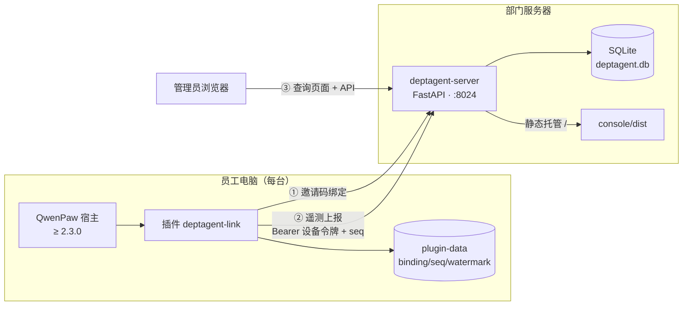

**设计原则**：控制面/员工端分离 · 竖切交付（每通道独立闭环） · 隐私最小化（不传对话内容） · seq 幂等防重放 · 格式不兼容时降级仅心跳。

---

## 2. 一次上报的完整链路

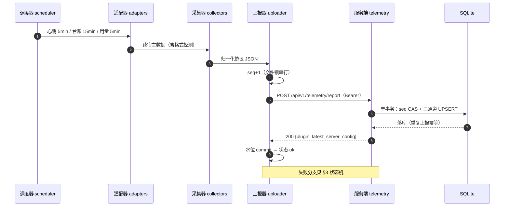

---

## 3. 上报状态机（心跳 / 台账 / 用量共用）

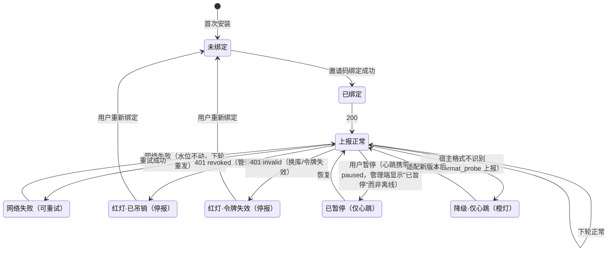

---

## 4. 服务端：三层 + 端点调用关系

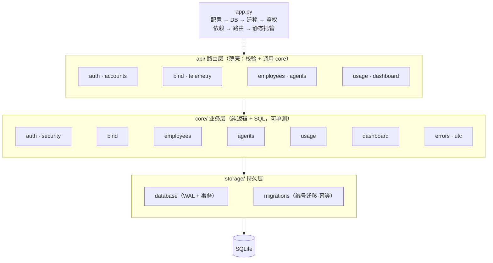

**谁调用哪些端点**：

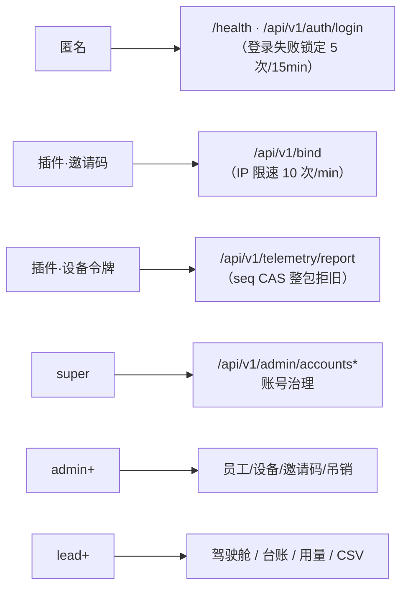

**三个关键机制**：

| 机制 | 实现 |
|---|---|
| seq 防重放 | `UPDATE devices SET last_seq=? WHERE id=? AND last_seq<?`，rowcount≠1 → 409 整包拒绝；客户端按响应重置后重报 |
| 字段白名单 | 上报只允许改 8 个设备字段 + 3 个智能体字段（name/description/last_seen），其余列服务端权威 |
| 宽松覆盖 | `None` 不冲掉旧值（COALESCE）——宿主升级字段消失不丢已有信息 |

---

## 5. 数据模型

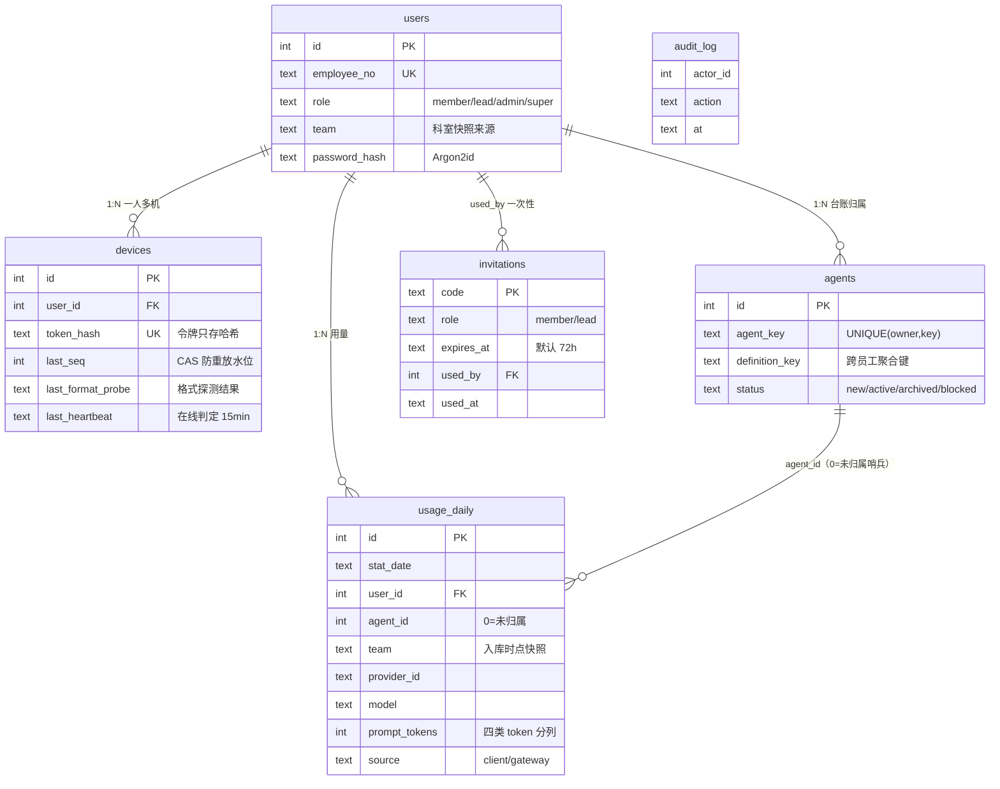

**`usage_report` VIEW**：`client` 与 `gateway` 双来源合并——同一 `(日期,用户,智能体,厂商,模型)` 存在网关计量行时屏蔽客户端行（网关优先）。

---

## 6. 管理端

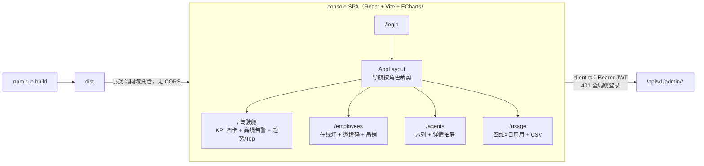

UI 只是裁剪入口，**服务端每端点独立鉴权**——member 直连 API 一律 403（双层兜底）。

---

## 7. 插件架构

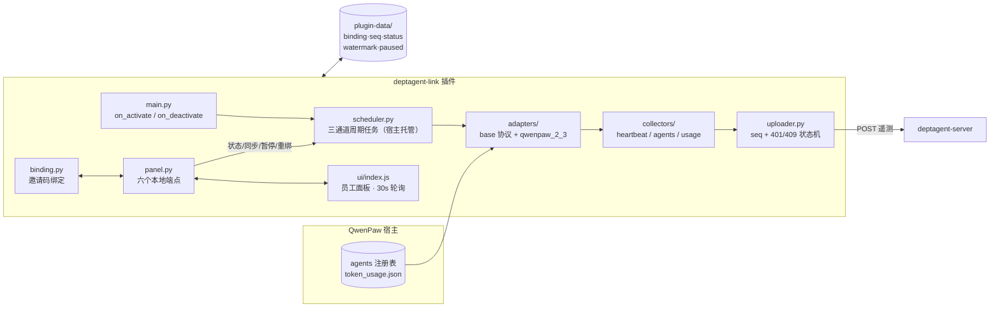

**宿主升级适配 = 新增一个 `adapters/qwenpaw_X_Y.py` + `detect_format` 分支**，collectors / uploader / 服务端零改动。

---

## 8. 插件生命周期

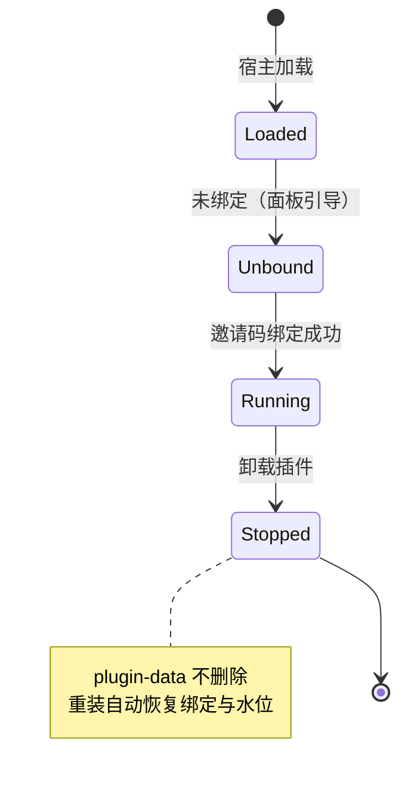

---

## 9. 权限模型

| 能力 | member | lead | admin | super |
|---|:-:|:-:|:-:|:-:|
| 插件面板（本人设备） | ✅ | ✅ | ✅ | ✅ |
| 驾驶舱 / 台账 / 用量 | ❌ | ✅ | ✅ | ✅ |
| 员工 / 邀请码 / 吊销设备 | ❌ | ❌ | ✅ | ✅ |
| 账号治理（建号/改角色/停用） | ❌ | ❌ | ❌ | ✅ |

JWT 只承载身份，**角色每请求查库**——改角色/停用即时生效，无需等 token 过期。

---

## 10. 部署形态

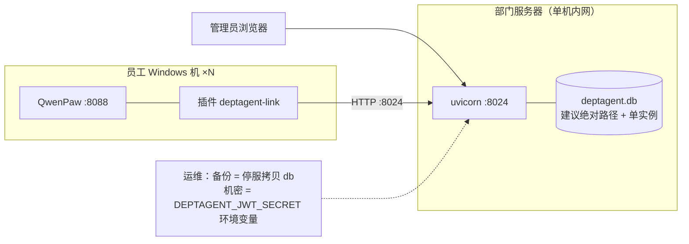

配置项：`DEPTAGENT_JWT_SECRET`（必填）· `DEPTAGENT_DB_PATH`（绝对路径）· `DEPTAGENT_CONSOLE_DIST`（可选覆盖）。

---

## 11. 质量保障与 CI

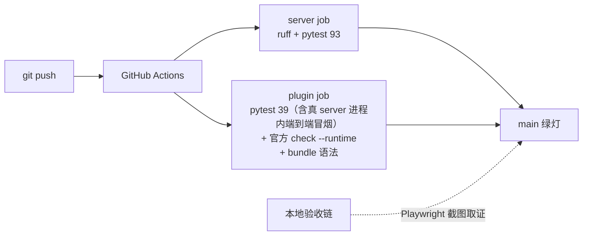

---

## 12. 二次开发扩展点

| 想做什么 | 改哪里 |
|---|---|
| 新增遥测通道 | `collectors/` 新文件 + `scheduler.py` 注册 + 服务端 `telemetry.py` 载荷段 + 新编号迁移 |
| 适配新版 QwenPaw | `adapters/qwenpaw_X_Y.py`（实现 AgentReader 协议）+ `detect_format` 分支 + `check --runtime` 验证 |
| 新增管理页面 | `console/src/pages/` + `client.ts` + 服务端 `core/` `api/` + `app.py` 挂路由 |
| 数据库变更 | `storage/migrations.py` **追加**新编号（不改历史版本） |
| 新增治理动作 | `api/` 端点 + `audit_log` 留痕 + 管理端入口（参考吊销设备） |

---

## 13. 目录结构

```
DeptAgent-Hub/
├── server/src/deptagent/{api,core,storage}/     FastAPI + SQLite（93 项测试）
├── console/src/{api,components,pages}/          React SPA（dist 由服务端托管）
├── client-plugin/deptagent-link/                插件（adapters/collectors/ui + 6 个 py）
├── client-plugin/tests/                         插件 39 项测试 + 端到端冒烟
├── docs/{SPEC.md, architecture.md, status.md, images/}
└── .github/workflows/ci.yml                     CI 双 job
```
