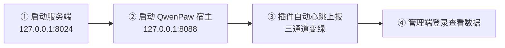

# 启动说明 · 真机演示手册

> 适用场景：在本机（Windows + PowerShell 5.1）启动完整演示环境——服务端 + 管理端 + QwenPaw 宿主 + `deptagent-link` 插件。按本文从零到可演示约 2 分钟。
> 命令全部可直接复制；路径以本机实际部署为准（`D:\project\DeptAgent-Hub`、`D:\project\Qwenpaw`）。

---

## 1. 环境事实（先对照，确认组件都在）

| 组件 | 位置 | 说明 |
|---|---|---|
| 服务端 | `D:\project\DeptAgent-Hub\server` | venv：`server\.venv`（Python 3.14），FastAPI + SQLite |
| 管理端 | `D:\project\DeptAgent-Hub\console\dist` | 已构建产物，服务端启动时自动托管，无需单独起前端 |
| QwenPaw 宿主 | `D:\project\Qwenpaw` | 独立 venv（Python 3.11），qwenpaw 2.3.0b3 + typesafe-sdk 0.7.5 |
| 插件 | `%USERPROFILE%\.qwenpaw\plugins\deptagent-link` | 已安装且 active；与工程源码 `client-plugin\deptagent-link` 内容一致 |
| 插件数据 | `%USERPROFILE%\.qwenpaw\plugin-data\deptagent-link\` | `binding.json` / `seq.json` / `watermark.json` 等；卸载插件不删除 |
| 演示数据库 | `D:\project\DeptAgent-Hub\server\deptagent.db` | 含试点数据：11 名员工 / 13 台设备 / 20 个智能体 |

---

## 2. 启动顺序（重要）



**必须先起服务端，再起 QwenPaw。** 插件在宿主启动后会立即发起首个心跳；若此时服务端未就绪，插件面板会记录一次 `network_error` 红灯（属正常韧性行为：5 分钟后自动重试，或点面板「立即同步」立即恢复）。

---

## 3. 第 1 步：启动服务端

开一个 PowerShell 窗口：

```powershell
cd D:\project\DeptAgent-Hub\server
$env:PYTHONUTF8="1"
$env:DEPTAGENT_DB_PATH="D:\project\DeptAgent-Hub\server\deptagent.db"
.\.venv\Scripts\python.exe -m uvicorn deptagent.app:create_app --factory --host 0.0.0.0 --port 8024
```

- 看到 `Application startup complete.` + `Uvicorn running on http://0.0.0.0:8024` 即成功
- 验证：`http://127.0.0.1:8024/health` 返回 `{"status":"ok","version":"0.1.0"}`
- 可选（推荐演示时设置）：`$env:DEPTAGENT_JWT_SECRET="<至少32位随机串>"`——不设置则每次重启 JWT 签名随机变化，所有已登录会话失效需重新登录

---

## 4. 第 2 步：启动 QwenPaw 宿主

另开一个 PowerShell 窗口：

```powershell
cd D:\project\Qwenpaw
$env:PYTHONUTF8="1"
.\.venv\Scripts\python.exe -m qwenpaw app
```

- 验证：`http://127.0.0.1:8088` 可访问
- 插件随宿主自动加载；若面板未显示三通道绿灯，见第 7 节排障

---

## 5. 演示入口与看点

| 入口 | 地址 | 账号 | 演示看点 |
|---|---|---|---|
| 管理端 | `http://127.0.0.1:8024` | `SUPER001` / `Test-12345`（演示库专用，生产必须更换） | 驾驶舱四卡与离线告警、员工与设备（在线灯/邀请码/吊销）、智能体台账（最近上报/详情抽屉）、用量分析（四维聚合/CSV 导出） |
| QwenPaw 员工端 | `http://127.0.0.1:8088` | 宿主自带登录 | 设置 → 扩展设置 → 部门智通：三通道信号灯、今日已上报透明展示、手动同步 / 暂停 / 重新绑定 / 诊断导出 |

**注意：管理端页面不会自动刷新**（进入时加载一次）。点「立即同步」后想看变化：驾驶舱点「刷新」按钮，或切到别的页再切回/按 F5。

---

## 6. 演示自查清单

- [ ] `http://127.0.0.1:8024/health` 返回 200
- [ ] 管理端能登录，驾驶舱四卡有值（智能体 20 / 活跃 19 / 本月 Token / 活跃员工 10）
- [ ] 员工端「部门智通」面板三通道全绿，心跳通道有你刚操作的时间
- [ ] 管理端「员工与设备」中 `EMP001` 在线灯为绿
- [ ] 若员工端首屏红灯：点「立即同步」→ 变绿后刷新管理端复核

> 离线告警里出现 `PC-EMP002~010` 属预期：它们是 T1.15 上墙用的模拟员工，只发过一次心跳，不会持续上报。

---

## 7. 常见问题（排障对照）

| 现象 | 原因 | 处理 |
|---|---|---|
| 插件面板三通道红，详情 `network_error: All connection attempts failed` | 宿主先于服务端启动 / 服务端未运行 | 确认服务端已起，点面板「立即同步」；或等 5 分钟周期自愈 |
| 点了「立即同步」管理端看不到变化 | 管理端无自动轮询，显示的是进入页面时的快照 | 驾驶舱点「刷新」；其它页切走再切回或 F5 |
| 用量通道显示 `skipped_no_data` | 今日尚无真实新增 Token 用量 | 正常，非报错；实际使用 QwenPaw 产生用量后会上报 |
| 员工端面板显示橙灯 | 宿主数据格式与插件适配器不匹配，已降级为仅心跳 | 属设计内降级；管理端可见 `format_mismatch`，跑 `check --runtime` 定位 |
| 重启后需重新登录管理端 | 未设置 `DEPTAGENT_JWT_SECRET`，JWT 签名每次随机 | 属预期；演示前设置固定 secret 可避免 |
| 别的机器打不开管理端 | 未监听 0.0.0.0 或防火墙未放行 | 按第 3 节用 `--host 0.0.0.0`，放行 8024 端口 |

---

## 8. 停止与重启

- 正常停止：两个窗口各按 `Ctrl+C`
- 兜底强制停止（窗口关不掉/后台残留）：

```powershell
Get-NetTCPConnection -State Listen -LocalPort 8024,8088 | Select-Object LocalPort,OwningProcess
taskkill /PID <上面查到的PID> /T /F
```

- 重启 = 按第 2 节顺序重新执行第 3、4 步；数据（绑定、上报水位、库记录）全部保留，无需重新绑定

---

## 9. 数据位置与备份

| 数据 | 位置 | 说明 |
|---|---|---|
| 服务端库 | `server\deptagent.db`（连带 `-wal` / `-shm`） | 备份 = 停服后拷贝这三个文件 |
| 插件本地状态 | `%USERPROFILE%\.qwenpaw\plugin-data\deptagent-link\` | 卸载插件不删除；删目录或换机才需重新输码绑定 |

---

## 10. 可选维护命令

```powershell
# 插件热装/升级（宿主运行中走 REST 热装，无需重启；数据保留）
$env:PYTHONUTF8="1"
D:\project\Qwenpaw\.venv\Scripts\python.exe -m qwenpaw plugin install D:\project\DeptAgent-Hub\client-plugin\deptagent-link

# 先卸载旧实例再装（如遇版本未更新）
curl.exe -X DELETE http://127.0.0.1:8088/api/plugins/deptagent-link --noproxy "*"

# 重置超管密码（幂等，可重复执行）
cd D:\project\DeptAgent-Hub\server
$env:PYTHONUTF8="1"
.\.venv\Scripts\python.exe -m deptagent --init-super SUPER001 --password "<新密码>"

# 重新构建管理端（改动 console 前端后）
cd D:\project\DeptAgent-Hub\console
npm run build
```

插件升级兼容性验证（从插件目录外执行，Windows 必须带 `PYTHONUTF8`）：

```powershell
$env:PYTHONUTF8="1"
cd D:\project\Qwenpaw
.\.venv\Scripts\python.exe -m qwenpaw.plugins.check D:\project\DeptAgent-Hub\client-plugin\deptagent-link --runtime
```

返回 `ok: true` 且 `findings: []` 为通过。
